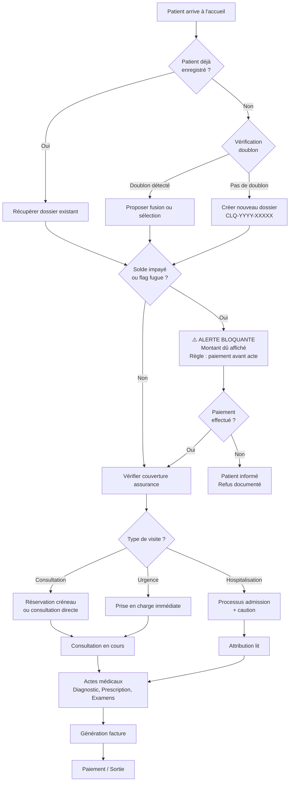
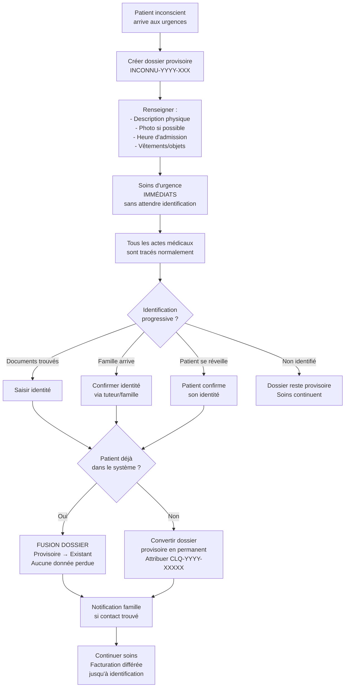
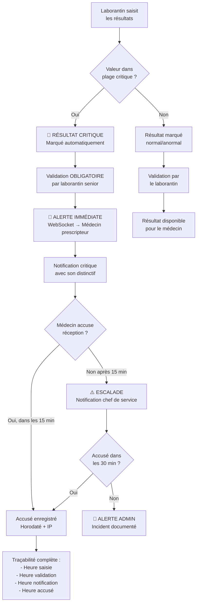
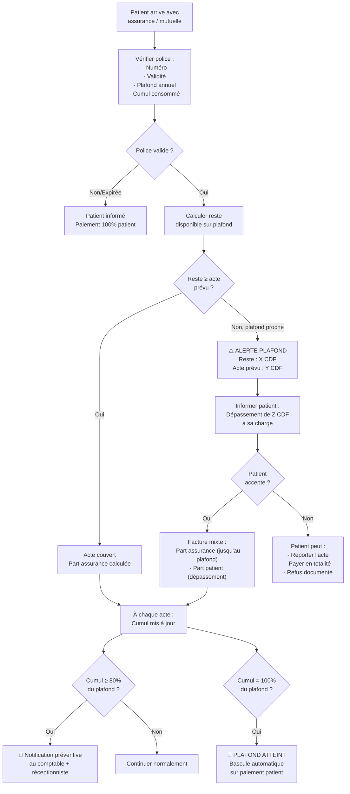
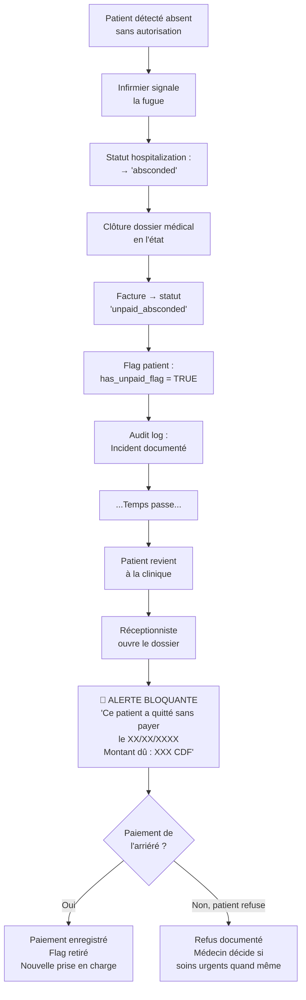
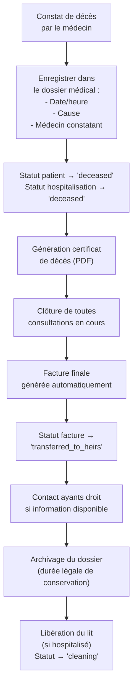
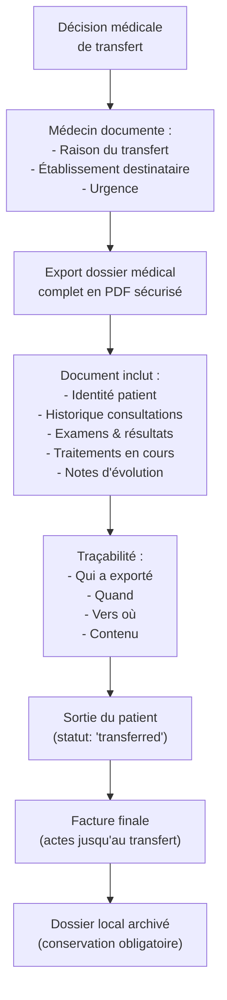

# MediTek — Système de Gestion Clinique

## Sprint 1 Polish : Auth & Patients (En attente de validation)

### Objectifs
Finaliser complètement les modules d'Authentification et de Gestion des Patients selon les retours du client pour assurer une cohérence visuelle stricte et 100% de fonctionnalité avant de passer aux autres modules.

### Problèmes identifiés & Corrections prévues
1. **Design System & Couleurs** : 
   - **Page de Connexion** : Supprimer toutes les références au bleu (`blue-600`, etc.) et utiliser la charte `Primary` (Vert médical profond `#0A6E4F`).
   - **Sidebar (MainLayout)** : Actuellement blanche. Le client souhaite une approche plus premium. Nous allons la passer en mode sombre (`Neutral 900` ou `Primary Dark`) avec des états de survol élégants, pour contraster avec le fond principal.
   - **Tableaux (PatientListPage)** : Les en-têtes doivent être verts (`bg-primary text-white`), les lignes impaires en gris très léger, et les lignes paires en blanc.
2. **Fonctionnalités manquantes** :
   - **Bouton Filtres** : Créer un panneau/modal fonctionnel pour filtrer les patients (par statut, sexe, groupe sanguin).
   - **Bouton Document** : Il s'agit du lien vers le détail du patient. La page `PatientDetailPage.tsx` n'existe pas encore. Nous allons la créer complètement.
   - **Page de Fusion (Merge)** : Implémenter la vue pour fusionner des dossiers en cas de doublon.
   - **Authentification** : Mettre en place un vrai bouton de déconnexion et protéger toutes les routes.

### Composants concernés
#### [MODIFY] r:\tutore_vrai\frontend\src\pages\auth\LoginPage.tsx
#### [MODIFY] r:\tutore_vrai\frontend\src\layouts\MainLayout.tsx
#### [MODIFY] r:\tutore_vrai\frontend\src\pages\patients\PatientListPage.tsx
#### [NEW] r:\tutore_vrai\frontend\src\pages\patients\PatientDetailPage.tsx
#### [NEW] r:\tutore_vrai\frontend\src\pages\patients\PatientMergePage.tsx
#### [MODIFY] r:\tutore_vrai\frontend\src\index.css

> [!IMPORTANT]
> **User Review Required**: Veuillez valider ce plan d'action. Dès que j'ai votre feu vert, je vais implémenter toutes ces corrections et les pages manquantes d'un seul trait. Est-ce que le passage de la barre latérale en sombre vous convient ?

---

## 1. Compréhension Globale du Projet

**MediTek** est une application de gestion clinique 100 % interne, conçue pour une clinique unique au Cameroun. Ce n'est pas un portail patient — c'est un outil métier professionnel utilisé par le personnel médical et administratif, couvrant l'intégralité du parcours patient : de l'admission à la sortie, en passant par les consultations, les examens, l'hospitalisation, la facturation, et l'archivage.

### Décisions clés
| Question | Réponse |
|---|---|
| **Nom du produit** | MediTek |
| **Pays / Devise** | Cameroun / FCFA (XAF) |
| **Architecture** | Mono-clinique (pas de multi-tenant) |
| **Langue UI** | Français uniquement |
| **Module Pharmacie** | Non inclus |
| **Imagerie** | Simple visionneuse JPG/PNG (pas de DICOM) |
| **Déploiement** | o2switch (hébergement mutualisé français) |

### Principes directeurs
- **Aucune donnée ne se perd** — soft delete systématique, audit log infalsifiable
- **La clinique protège ses revenus** — alertes impayés, plafonds assurance, traçabilité financière
- **Le dossier médical est sacré** — fusion de doublons propre, identité provisoire, continuité des données
- **Le système est conçu pour des professionnels fatigués** — UX dense mais lisible, actions en 2 clics max
- **Conformité légale** — durées de conservation, consentement éclairé, export réglementaire

### Contraintes de déploiement o2switch

> [!WARNING]
> o2switch est un hébergement mutualisé. Cela impose des contraintes techniques importantes :

o2switch offre : SSH, Python via Passenger WSGI, MySQL/MariaDB, cron jobs, et des ressources "illimitées".

| Contrainte | Impact | Solution retenue |
|---|---|---|
| **Pas de WebSocket natif** | Notifications temps réel impossibles via WS | **Polling AJAX** toutes les 30s pour les notifications + badge compteur |
| **Pas de Redis** | Celery ne peut pas tourner | **Django-Q2** avec backend base de données (ORM) pour les tâches async, ou exécution synchrone + cron jobs |
| **MySQL au lieu de PostgreSQL** | Pas de partitionnement natif, pas de `INET`, pas de `gen_random_uuid()` | On utilise **MySQL/MariaDB** avec UUIDs générés côté Django, audit log en table simple (pas de partition) |
| **Pas de worker permanent** | Pas de processus long en arrière-plan | **Cron jobs** o2switch pour les tâches planifiées (archivage auto, rappels, rapports) |
| **Stockage fichiers** | Pas de S3 | **Stockage local** dans `media/` — les fichiers uploadés sont sur le serveur o2switch |
| **ASGI impossible** | Pas de Django Channels | On reste en **WSGI** (Passenger) — notifications par polling |

---

## 2. Charte Graphique — Design System "MediTek"

```
Couleurs principales :
├── Primary        : #0A6E4F  (Vert médical profond — confiance, sobriété)
├── Primary Light  : #E8F5F0  (Fond surlignage vert pâle)
├── Primary Dark   : #064E38  (Headers, états actifs)
├── Secondary      : #F8FAFC  (Blanc cassé — fond principal)
├── Accent         : #2563EB  (Bleu slate — CTAs, liens, actions)
├── Accent Light   : #EFF6FF  (Fond bleu pâle)
├── Danger         : #DC2626  (Alertes, erreurs, résultats critiques)
├── Danger Light   : #FEF2F2
├── Warning        : #D97706  (Avertissements, plafonds)
├── Warning Light  : #FFFBEB
├── Success        : #059669  (Validations, résultats normaux)
├── Success Light  : #ECFDF5
├── Neutral 50     : #F8FAFC
├── Neutral 100    : #F1F5F9
├── Neutral 200    : #E2E8F0
├── Neutral 300    : #CBD5E1
├── Neutral 400    : #94A3B8
├── Neutral 500    : #64748B
├── Neutral 600    : #475569
├── Neutral 700    : #334155
├── Neutral 800    : #1E293B
├── Neutral 900    : #0F172A

Typographie :
├── Titres (h1-h3) : Plus Jakarta Sans  — 700/600 weight
├── Corps & UI     : Inter              — 400/500/600 weight
├── Monospace      : JetBrains Mono     — codes, IDs dossiers

Spacing & Layout :
├── Sidebar        : 260px fixe, collapsible à 72px (icônes)
├── Topbar         : 64px, contextuelle (breadcrumb + actions + notifications + user)
├── Content        : max-width 1440px, padding 24px
├── Radius         : 6px (petits), 8px (cards), 12px (modals)
├── Shadows        : sm (cards), md (dropdowns), lg (modals)

Composants clés customisés :
├── StatusBadge    : pill arrondi, couleur sémantique (Planifié=bleu, En cours=jaune, Terminé=vert, Critique=rouge pulsant)
├── MedicalTable   : headers gris-bleuté, lignes alternées, actions inline, tri/filtre colonnes
├── PatientCard    : avatar + NIP + nom + âge + groupe sanguin + allergies badge + solde impayé si > 0
├── AlertBanner    : barre pleine largeur, icône + message + action, 4 variantes (info/warning/danger/success)
├── KPICard        : valeur grande + label + tendance (↑↓) + sparkline
├── Timeline       : verticale, points colorés, pour historique patient
```

---

## 3. Architecture des Rôles & Permissions

### Matrice des Rôles

| Module / Action | Super Admin | Médecin | Infirmier | Réceptionniste | Comptable | Archiviste | Laborantin | Radiologue |
|---|---|---|---|---|---|---|---|---|
| **Patients** — Créer | ✅ | ✅ | ❌ | ✅ | ❌ | ❌ | ❌ | ❌ |
| **Patients** — Lire tous | ✅ | ❌¹ | ❌¹ | ✅ | ❌ | ✅ (archivés) | ❌ | ❌ |
| **Patients** — Modifier | ✅ | ✅¹ | ❌ | ✅ (admin only) | ❌ | ❌ | ❌ | ❌ |
| **Patients** — Fusionner doublons | ✅ | ❌ | ❌ | ❌ | ❌ | ❌ | ❌ | ❌ |
| **Consultations** — Créer | ✅ | ✅ | ❌ | ❌ | ❌ | ❌ | ❌ | ❌ |
| **Consultations** — Lire | ✅ | ✅¹ | ✅¹ | ❌ | ❌ | ✅ (archivés) | ❌ | ❌ |
| **Consultations** — Prescrire | ❌ | ✅ | ❌ | ❌ | ❌ | ❌ | ❌ | ❌ |
| **Hospitalisations** — Admettre | ✅ | ✅ | ❌ | ✅ | ❌ | ❌ | ❌ | ❌ |
| **Hospitalisations** — Soins infirmiers | ✅ | ✅ | ✅ | ❌ | ❌ | ❌ | ❌ | ❌ |
| **Hospitalisations** — Sortie | ✅ | ✅ | ❌ | ❌ | ❌ | ❌ | ❌ | ❌ |
| **Rendez-vous** — Gérer | ✅ | ✅² | ❌ | ✅ | ❌ | ❌ | ❌ | ❌ |
| **Labo** — Demander examen | ✅ | ✅ | ❌ | ❌ | ❌ | ❌ | ❌ | ❌ |
| **Labo** — Saisir résultats | ✅ | ❌ | ❌ | ❌ | ❌ | ❌ | ✅ | ❌ |
| **Labo** — Valider résultats | ✅ | ❌ | ❌ | ❌ | ❌ | ❌ | ✅ | ❌ |
| **Imagerie** — Upload/Annoter | ✅ | ❌ | ❌ | ❌ | ❌ | ❌ | ❌ | ✅ |
| **Facturation** — Créer facture | ✅ | ❌ | ❌ | ✅ (partiel) | ✅ | ❌ | ❌ | ❌ |
| **Facturation** — Encaisser | ✅ | ❌ | ❌ | ✅ | ✅ | ❌ | ❌ | ❌ |
| **Facturation** — Rapports financiers | ✅ | ❌ | ❌ | ❌ | ✅ | ❌ | ❌ | ❌ |
| **Archives** — Consulter | ✅ | ❌ | ❌ | ❌ | ❌ | ✅ | ❌ | ❌ |
| **Archives** — Archiver | ✅ | ❌ | ❌ | ❌ | ❌ | ✅ | ❌ | ❌ |
| **Config système** | ✅ | ❌ | ❌ | ❌ | ❌ | ❌ | ❌ | ❌ |
| **Audit logs** — Lire | ✅ | ❌ | ❌ | ❌ | ❌ | ❌ | ❌ | ❌ |
| **Notifications** — Recevoir | ✅ | ✅ | ✅ | ✅ | ✅ | ❌ | ✅ | ✅ |
| **Statistiques** — Dashboard | ✅ (tout) | ✅ (clinique) | ✅ (soins) | ✅ (accueil) | ✅ (finance) | ❌ | ✅ (labo) | ✅ (imagerie) |

> ¹ Limité aux patients assignés / du service  
> ² Le médecin voit son propre agenda, ne peut pas gérer celui des autres

---

## 4. Modèle de Données PostgreSQL Complet

### Diagramme Entité-Relation (Simplifié)

```mermaid
erDiagram
    CLINIC ||--o{ STAFF : emploie
    STAFF ||--o{ STAFF_ROLE : a
    ROLE ||--o{ STAFF_ROLE : définit
    ROLE ||--o{ ROLE_PERMISSION : contient
    PERMISSION ||--o{ ROLE_PERMISSION : attribuée_à

    PATIENT ||--o{ PATIENT_CONTACT : a
    PATIENT ||--o{ PATIENT_ALLERGY : a
    PATIENT ||--o{ PATIENT_ANTECEDENT : a
    PATIENT ||--o{ PATIENT_DOCUMENT : possède
    PATIENT ||--o{ CONSULTATION : reçoit
    PATIENT ||--o{ HOSPITALIZATION : est_admis
    PATIENT ||--o{ APPOINTMENT : planifié
    PATIENT ||--o{ INVOICE : facturé
    PATIENT ||--o{ LAB_REQUEST : examiné
    PATIENT }o--o| PATIENT : tuteur_légal
    PATIENT }o--o| INSURANCE_COVERAGE : couvert_par

    CONSULTATION ||--o{ PRESCRIPTION : génère
    CONSULTATION ||--o{ LAB_REQUEST : demande
    CONSULTATION ||--o{ VITAL_SIGNS : mesure
    CONSULTATION ||--o{ EVOLUTION_NOTE : documente
    CONSULTATION }o--|| STAFF : par_médecin
    CONSULTATION }o--|| ICD10_CODE : diagnostique

    HOSPITALIZATION ||--o{ BED_ASSIGNMENT : occupe
    HOSPITALIZATION ||--o{ NURSING_SHEET : suivi_par
    HOSPITALIZATION ||--o{ TRANSFER : transféré
    BED ||--o{ BED_ASSIGNMENT : attribué

    LAB_REQUEST ||--o{ LAB_RESULT : produit
    LAB_REQUEST }o--|| EXAM_TYPE : type
    IMAGING_REQUEST ||--o{ IMAGING_RESULT : produit

    INVOICE ||--o{ INVOICE_LINE : contient
    INVOICE ||--o{ PAYMENT : réglée_par
    INVOICE }o--o| INSURANCE_COVERAGE : prise_en_charge

    AUDIT_LOG }o--|| STAFF : par
```



### Tables Détaillées

#### 4.1 — Core: Clinique & Personnel

```sql
-- ============================================================
-- TABLE: clinic
-- Configuration de la clinique (mono-clinique)
-- ============================================================
CREATE TABLE clinic (
    id              CHAR(36) PRIMARY KEY,  -- UUID généré par Django
    name            VARCHAR(255) NOT NULL,
    legal_name      VARCHAR(255),
    address         TEXT,
    phone           VARCHAR(30),
    email           VARCHAR(255),
    logo_url        TEXT,
    license_number  VARCHAR(100),
    country_code    CHAR(2) DEFAULT 'CM',  -- Cameroun
    currency_code   CHAR(3) DEFAULT 'XAF', -- FCFA
    timezone        VARCHAR(50) DEFAULT 'Africa/Douala',
    -- Configuration archivage
    archive_after_years     INT DEFAULT 5,
    retention_years         INT DEFAULT 20,
    -- Métadonnées
    created_at      DATETIME DEFAULT CURRENT_TIMESTAMP,
    updated_at      DATETIME DEFAULT CURRENT_TIMESTAMP ON UPDATE CURRENT_TIMESTAMP,
    deleted_at      DATETIME NULL  -- soft delete
) ENGINE=InnoDB DEFAULT CHARSET=utf8mb4;

-- ============================================================
-- TABLE: staff
-- Personnel de la clinique (extend Django User)
-- ============================================================
CREATE TABLE staff (
    id              CHAR(36) PRIMARY KEY,
    user_id         INT UNIQUE NOT NULL,  -- FK auth_user
    employee_number VARCHAR(30) UNIQUE NOT NULL,  -- ex: EMP-2024-001
    first_name      VARCHAR(100) NOT NULL,
    last_name       VARCHAR(100) NOT NULL,
    title           VARCHAR(20),  -- Dr., Pr., Inf., etc.
    specialization  VARCHAR(150),
    phone           VARCHAR(30),
    email           VARCHAR(255),
    avatar_url      TEXT,
    signature_url   TEXT,  -- Signature électronique (image)
    license_number  VARCHAR(100),  -- Numéro d'ordre (médecins)
    is_active       BOOLEAN DEFAULT TRUE,
    departure_date  DATE,
    departed_reason VARCHAR(50),  -- 'resigned', 'terminated', 'retired', 'transferred'
    created_at      DATETIME DEFAULT CURRENT_TIMESTAMP,
    updated_at      DATETIME DEFAULT CURRENT_TIMESTAMP ON UPDATE CURRENT_TIMESTAMP,
    deleted_at      DATETIME NULL
) ENGINE=InnoDB DEFAULT CHARSET=utf8mb4;

CREATE INDEX idx_staff_user ON staff(user_id);
CREATE INDEX idx_staff_employee_number ON staff(employee_number);

-- ============================================================
-- TABLE: role
-- ============================================================
CREATE TABLE role (
    id          CHAR(36) PRIMARY KEY,
    code        VARCHAR(50) UNIQUE NOT NULL,  -- 'super_admin', 'medecin', 'infirmier', etc.
    name        VARCHAR(100) NOT NULL,
    description TEXT,
    is_system   BOOLEAN DEFAULT FALSE,
    created_at  DATETIME DEFAULT CURRENT_TIMESTAMP
) ENGINE=InnoDB DEFAULT CHARSET=utf8mb4;

-- ============================================================
-- TABLE: permission
-- ============================================================
CREATE TABLE permission (
    id          CHAR(36) PRIMARY KEY,
    code        VARCHAR(100) UNIQUE NOT NULL,
    module      VARCHAR(50) NOT NULL,
    action      VARCHAR(30) NOT NULL,
    description TEXT
) ENGINE=InnoDB DEFAULT CHARSET=utf8mb4;

-- ============================================================
-- TABLE: role_permission (jonction)
-- ============================================================
CREATE TABLE role_permission (
    role_id       CHAR(36) NOT NULL,
    permission_id CHAR(36) NOT NULL,
    PRIMARY KEY (role_id, permission_id)
) ENGINE=InnoDB DEFAULT CHARSET=utf8mb4;

-- ============================================================
-- TABLE: staff_role (jonction — un staff peut avoir plusieurs rôles)
-- ============================================================
CREATE TABLE staff_role (
    staff_id    CHAR(36) NOT NULL,
    role_id     CHAR(36) NOT NULL,
    assigned_at DATETIME DEFAULT CURRENT_TIMESTAMP,
    assigned_by CHAR(36),
    PRIMARY KEY (staff_id, role_id)
) ENGINE=InnoDB DEFAULT CHARSET=utf8mb4;

-- NOTE: Toutes les tables suivantes utilisent le même pattern :
-- CHAR(36) pour les UUIDs, DATETIME au lieu de TIMESTAMPTZ,
-- ENGINE=InnoDB DEFAULT CHARSET=utf8mb4.
-- Les FK sont gérées par Django ORM, pas dans le SQL brut ici
-- (pour compatibilité MySQL/MariaDB sur o2switch).
```

#### 4.2 — Module Patients

```sql
-- ============================================================
-- TABLE: patient
-- ============================================================
CREATE TABLE patient (
    id                  UUID PRIMARY KEY DEFAULT gen_random_uuid(),
    medical_record_number VARCHAR(30) UNIQUE NOT NULL,  -- MDK-2024-00342
    -- Identité
    first_name          VARCHAR(100) NOT NULL,
    last_name           VARCHAR(100) NOT NULL,
    date_of_birth       DATE,
    gender              VARCHAR(10) CHECK (gender IN ('M','F','other','unknown')),
    -- Statut spécial
    is_provisional      BOOLEAN DEFAULT FALSE,  -- Identité provisoire (patient inconscient)
    provisional_description TEXT,               -- Description physique si inconscient
    admission_photo_url TEXT,                   -- Photo à l'admission (inconscient)
    merged_into_id      UUID REFERENCES patient(id),  -- Si fusionné, pointe vers le dossier principal
    -- Identité complète
    national_id         VARCHAR(50),    -- Numéro d'identité nationale (chiffré)
    passport_number     VARCHAR(50),    -- Pour patients étrangers
    nationality         CHAR(2),        -- Code ISO pays
    preferred_language  VARCHAR(10) DEFAULT 'fr',
    -- Coordonnées
    phone_primary       VARCHAR(30),
    phone_secondary     VARCHAR(30),
    email               VARCHAR(255),
    address             TEXT,
    city                VARCHAR(100),
    -- Informations médicales de base
    blood_group         VARCHAR(5) CHECK (blood_group IN ('A+','A-','B+','B-','AB+','AB-','O+','O-', NULL)),
    -- Mineur / Tuteur
    is_minor            BOOLEAN DEFAULT FALSE,
    guardian_id         UUID REFERENCES patient(id),  -- Tuteur légal (aussi un "patient" dans le système)
    guardian_relationship VARCHAR(50),  -- 'parent', 'tuteur_légal', etc.
    -- Étranger
    is_foreign          BOOLEAN DEFAULT FALSE,
    preferred_currency  CHAR(3),  -- Si différent de la devise clinique
    -- Statut financier
    outstanding_balance DECIMAL(15,2) DEFAULT 0.00,  -- Solde impayé (calculé)
    credit_balance      DECIMAL(15,2) DEFAULT 0.00,  -- Trop-perçu (crédit)
    -- Statut dossier
    status              VARCHAR(20) DEFAULT 'active' CHECK (status IN ('active','inactive','archived','deceased','merged')),
    death_date          DATE,
    death_certificate_number VARCHAR(100),
    -- Alertes
    no_show_count       INT DEFAULT 0,
    has_unpaid_flag     BOOLEAN DEFAULT FALSE,  -- Flag fugue financière
    -- Archivage
    archived_at         TIMESTAMPTZ,
    last_visit_date     DATE,
    -- Métadonnées
    created_by          UUID REFERENCES staff(id),
    created_at          TIMESTAMPTZ DEFAULT NOW(),
    updated_at          TIMESTAMPTZ DEFAULT NOW(),
    deleted_at          TIMESTAMPTZ
);

CREATE INDEX idx_patient_mrn ON patient(medical_record_number);
CREATE INDEX idx_patient_name ON patient(last_name, first_name);
CREATE INDEX idx_patient_dob ON patient(date_of_birth);
CREATE INDEX idx_patient_phone ON patient(phone_primary);
CREATE INDEX idx_patient_national_id ON patient(national_id);
CREATE INDEX idx_patient_clinic ON patient(clinic_id);
CREATE INDEX idx_patient_status ON patient(status);
CREATE INDEX idx_patient_guardian ON patient(guardian_id);

-- ============================================================
-- TABLE: patient_contact (contacts d'urgence)
-- ============================================================
CREATE TABLE patient_contact (
    id              UUID PRIMARY KEY DEFAULT gen_random_uuid(),
    patient_id      UUID NOT NULL REFERENCES patient(id),
    full_name       VARCHAR(200) NOT NULL,
    relationship    VARCHAR(50) NOT NULL,
    phone           VARCHAR(30) NOT NULL,
    is_primary      BOOLEAN DEFAULT FALSE,
    created_at      TIMESTAMPTZ DEFAULT NOW()
);

-- ============================================================
-- TABLE: patient_allergy
-- ============================================================
CREATE TABLE patient_allergy (
    id              UUID PRIMARY KEY DEFAULT gen_random_uuid(),
    patient_id      UUID NOT NULL REFERENCES patient(id),
    allergen        VARCHAR(200) NOT NULL,
    severity        VARCHAR(20) CHECK (severity IN ('mild','moderate','severe','life_threatening')),
    reaction        TEXT,
    noted_by        UUID REFERENCES staff(id),
    noted_at        TIMESTAMPTZ DEFAULT NOW()
);

-- ============================================================
-- TABLE: patient_antecedent
-- ============================================================
CREATE TABLE patient_antecedent (
    id              UUID PRIMARY KEY DEFAULT gen_random_uuid(),
    patient_id      UUID NOT NULL REFERENCES patient(id),
    type            VARCHAR(30) NOT NULL CHECK (type IN ('medical','surgical','family','obstetric','lifestyle')),
    description     TEXT NOT NULL,
    date_noted      DATE,
    noted_by        UUID REFERENCES staff(id),
    created_at      TIMESTAMPTZ DEFAULT NOW()
);

-- ============================================================
-- TABLE: patient_chronic_condition
-- ============================================================
CREATE TABLE patient_chronic_condition (
    id              UUID PRIMARY KEY DEFAULT gen_random_uuid(),
    patient_id      UUID NOT NULL REFERENCES patient(id),
    icd10_code      VARCHAR(10),
    condition_name  VARCHAR(200) NOT NULL,
    diagnosed_date  DATE,
    status          VARCHAR(20) DEFAULT 'active' CHECK (status IN ('active','resolved','managed')),
    notes           TEXT,
    created_at      TIMESTAMPTZ DEFAULT NOW()
);

-- ============================================================
-- TABLE: patient_vaccination
-- ============================================================
CREATE TABLE patient_vaccination (
    id              UUID PRIMARY KEY DEFAULT gen_random_uuid(),
    patient_id      UUID NOT NULL REFERENCES patient(id),
    vaccine_name    VARCHAR(200) NOT NULL,
    dose_number     INT,
    administered_date DATE,
    administered_by UUID REFERENCES staff(id),
    lot_number      VARCHAR(50),
    notes           TEXT,
    created_at      TIMESTAMPTZ DEFAULT NOW()
);

-- ============================================================
-- TABLE: patient_document
-- ============================================================
CREATE TABLE patient_document (
    id              UUID PRIMARY KEY DEFAULT gen_random_uuid(),
    patient_id      UUID NOT NULL REFERENCES patient(id),
    document_type   VARCHAR(50) NOT NULL,  -- 'identity','prescription_ext','lab_result_ext','discharge_summary','consent_form','other'
    title           VARCHAR(255) NOT NULL,
    file_url        TEXT NOT NULL,
    file_size       BIGINT,
    mime_type       VARCHAR(100),
    uploaded_by     UUID REFERENCES staff(id),
    created_at      TIMESTAMPTZ DEFAULT NOW(),
    deleted_at      TIMESTAMPTZ
);

-- ============================================================
-- TABLE: patient_merge_log (traçabilité des fusions)
-- ============================================================
CREATE TABLE patient_merge_log (
    id              UUID PRIMARY KEY DEFAULT gen_random_uuid(),
    source_patient_id UUID NOT NULL,  -- L'ancien dossier (absorbé)
    target_patient_id UUID NOT NULL REFERENCES patient(id),  -- Le dossier qui reste
    merged_by       UUID NOT NULL REFERENCES staff(id),
    merge_reason    TEXT,
    data_snapshot   JSONB,  -- Snapshot des données du source avant fusion
    merged_at       TIMESTAMPTZ DEFAULT NOW()
);

-- ============================================================
-- TABLE: consent_record (consentement éclairé)
-- ============================================================
CREATE TABLE consent_record (
    id              UUID PRIMARY KEY DEFAULT gen_random_uuid(),
    patient_id      UUID NOT NULL REFERENCES patient(id),
    consent_type    VARCHAR(50) NOT NULL,  -- 'treatment','surgery','data_sharing','refusal'
    description     TEXT NOT NULL,
    is_granted      BOOLEAN NOT NULL,  -- TRUE = consentement donné, FALSE = refus
    document_url    TEXT,  -- Document signé scanné
    witness_name    VARCHAR(200),
    recorded_by     UUID NOT NULL REFERENCES staff(id),
    recorded_at     TIMESTAMPTZ DEFAULT NOW()
);
```

#### 4.3 — Module Consultations

```sql
-- ============================================================
-- TABLE: consultation
-- ============================================================
CREATE TABLE consultation (
    id                  UUID PRIMARY KEY DEFAULT gen_random_uuid(),
    clinic_id           UUID NOT NULL REFERENCES clinic(id),
    consultation_number VARCHAR(30) UNIQUE NOT NULL,  -- MDK-C-2024-00142
    patient_id          UUID NOT NULL REFERENCES patient(id),
    doctor_id           UUID NOT NULL REFERENCES staff(id),
    -- Lien avec consultation précédente (suivi)
    parent_consultation_id UUID REFERENCES consultation(id),
    -- Contenu clinique
    chief_complaint     TEXT NOT NULL,  -- Motif de consultation
    anamnesis           TEXT,           -- Histoire de la maladie
    physical_examination TEXT,          -- Examen physique structuré
    -- Diagnostic
    primary_diagnosis_icd10 VARCHAR(10),
    primary_diagnosis_text  TEXT,
    -- Notes
    clinical_notes      TEXT,
    plan                TEXT,  -- Plan de traitement
    -- Statut
    status              VARCHAR(20) DEFAULT 'in_progress' CHECK (status IN ('scheduled','in_progress','completed','cancelled')),
    consultation_type   VARCHAR(30) DEFAULT 'standard' CHECK (consultation_type IN ('standard','follow_up','emergency','specialist')),
    -- Signature
    signed_by           UUID REFERENCES staff(id),
    signed_at           TIMESTAMPTZ,
    signature_hash      VARCHAR(128),  -- Hash de vérification
    -- Métadonnées
    started_at          TIMESTAMPTZ DEFAULT NOW(),
    completed_at        TIMESTAMPTZ,
    created_at          TIMESTAMPTZ DEFAULT NOW(),
    updated_at          TIMESTAMPTZ DEFAULT NOW(),
    deleted_at          TIMESTAMPTZ
);

CREATE INDEX idx_consultation_patient ON consultation(patient_id);
CREATE INDEX idx_consultation_doctor ON consultation(doctor_id);
CREATE INDEX idx_consultation_date ON consultation(started_at);

-- ============================================================
-- TABLE: icd10_code (référentiel CIM-10)
-- ============================================================
CREATE TABLE icd10_code (
    id          UUID PRIMARY KEY DEFAULT gen_random_uuid(),
    code        VARCHAR(10) UNIQUE NOT NULL,
    description_fr TEXT NOT NULL,
    description_en TEXT,
    category    VARCHAR(100),
    is_active   BOOLEAN DEFAULT TRUE
);

CREATE INDEX idx_icd10_code ON icd10_code(code);
CREATE INDEX idx_icd10_desc ON icd10_code USING gin(to_tsvector('french', description_fr));

-- ============================================================
-- TABLE: consultation_diagnosis (un à plusieurs diagnostics)
-- ============================================================
CREATE TABLE consultation_diagnosis (
    id              UUID PRIMARY KEY DEFAULT gen_random_uuid(),
    consultation_id UUID NOT NULL REFERENCES consultation(id),
    icd10_code      VARCHAR(10),
    diagnosis_text  TEXT NOT NULL,
    is_primary      BOOLEAN DEFAULT FALSE,
    certainty       VARCHAR(20) DEFAULT 'confirmed' CHECK (certainty IN ('suspected','probable','confirmed','ruled_out')),
    created_at      TIMESTAMPTZ DEFAULT NOW()
);

-- ============================================================
-- TABLE: vital_signs
-- ============================================================
CREATE TABLE vital_signs (
    id              UUID PRIMARY KEY DEFAULT gen_random_uuid(),
    patient_id      UUID NOT NULL REFERENCES patient(id),
    consultation_id UUID REFERENCES consultation(id),
    hospitalization_id UUID REFERENCES hospitalization(id),
    -- Mesures
    systolic_bp     INT,      -- Tension systolique (mmHg)
    diastolic_bp    INT,      -- Tension diastolique (mmHg)
    heart_rate      INT,      -- Pouls (bpm)
    temperature     DECIMAL(4,1),  -- Température (°C)
    spo2            INT,      -- Saturation O2 (%)
    respiratory_rate INT,     -- Fréquence respiratoire
    weight          DECIMAL(5,1),  -- Poids (kg)
    height          DECIMAL(5,1),  -- Taille (cm)
    bmi             DECIMAL(4,1),  -- IMC (calculé)
    blood_sugar     DECIMAL(5,1),  -- Glycémie (mg/dL)
    -- Métadonnées
    measured_by     UUID NOT NULL REFERENCES staff(id),
    measured_at     TIMESTAMPTZ DEFAULT NOW(),
    notes           TEXT
);

CREATE INDEX idx_vital_signs_patient ON vital_signs(patient_id);
CREATE INDEX idx_vital_signs_date ON vital_signs(measured_at);

-- ============================================================
-- TABLE: prescription
-- ============================================================
CREATE TABLE prescription (
    id              UUID PRIMARY KEY DEFAULT gen_random_uuid(),
    consultation_id UUID NOT NULL REFERENCES consultation(id),
    patient_id      UUID NOT NULL REFERENCES patient(id),
    prescribed_by   UUID NOT NULL REFERENCES staff(id),
    prescription_number VARCHAR(30) UNIQUE NOT NULL,  -- ORD-2024-00123
    status          VARCHAR(20) DEFAULT 'active' CHECK (status IN ('active','dispensed','cancelled','expired')),
    notes           TEXT,
    -- Correction d'erreur
    is_amended      BOOLEAN DEFAULT FALSE,
    amendment_reason TEXT,
    original_prescription_id UUID REFERENCES prescription(id),
    -- PDF
    pdf_url         TEXT,
    -- Signature
    signed_at       TIMESTAMPTZ,
    created_at      TIMESTAMPTZ DEFAULT NOW(),
    deleted_at      TIMESTAMPTZ
);

-- ============================================================
-- TABLE: prescription_item
-- ============================================================
CREATE TABLE prescription_item (
    id              UUID PRIMARY KEY DEFAULT gen_random_uuid(),
    prescription_id UUID NOT NULL REFERENCES prescription(id),
    medication_name VARCHAR(255) NOT NULL,
    dosage          VARCHAR(100) NOT NULL,  -- ex: "500mg"
    frequency       VARCHAR(100) NOT NULL,  -- ex: "3x/jour"
    duration        VARCHAR(100),           -- ex: "7 jours"
    route           VARCHAR(50),            -- 'oral','iv','im','topical', etc.
    instructions    TEXT,                   -- Instructions spéciales
    quantity        INT,
    sort_order      INT DEFAULT 0
);

-- ============================================================
-- TABLE: evolution_note (notes d'évolution - hospitalisés)
-- ============================================================
CREATE TABLE evolution_note (
    id              UUID PRIMARY KEY DEFAULT gen_random_uuid(),
    patient_id      UUID NOT NULL REFERENCES patient(id),
    hospitalization_id UUID NOT NULL REFERENCES hospitalization(id),
    author_id       UUID NOT NULL REFERENCES staff(id),
    note_date       DATE NOT NULL,
    subjective      TEXT,  -- S (SOAP)
    objective       TEXT,  -- O
    assessment      TEXT,  -- A
    plan            TEXT,  -- P
    signed_at       TIMESTAMPTZ,
    created_at      TIMESTAMPTZ DEFAULT NOW(),
    updated_at      TIMESTAMPTZ DEFAULT NOW(),
    deleted_at      TIMESTAMPTZ,
    UNIQUE(hospitalization_id, author_id, note_date)  -- 1 note/jour/médecin
);
```

#### 4.4 — Module Hospitalisation & Lits

```sql
-- ============================================================
-- TABLE: service (services/départements)
-- ============================================================
CREATE TABLE service (
    id          UUID PRIMARY KEY DEFAULT gen_random_uuid(),
    clinic_id   UUID NOT NULL REFERENCES clinic(id),
    name        VARCHAR(100) NOT NULL,  -- 'Chirurgie', 'Pédiatrie', 'Urgences', etc.
    code        VARCHAR(20) UNIQUE NOT NULL,
    floor       INT,
    head_doctor_id UUID REFERENCES staff(id),
    is_active   BOOLEAN DEFAULT TRUE,
    created_at  TIMESTAMPTZ DEFAULT NOW()
);

-- ============================================================
-- TABLE: room
-- ============================================================
CREATE TABLE room (
    id          UUID PRIMARY KEY DEFAULT gen_random_uuid(),
    service_id  UUID NOT NULL REFERENCES service(id),
    room_number VARCHAR(20) NOT NULL,
    room_type   VARCHAR(30) CHECK (room_type IN ('standard','private','icu','operating','consultation','isolation')),
    floor       INT,
    capacity    INT DEFAULT 1,
    is_active   BOOLEAN DEFAULT TRUE,
    UNIQUE(service_id, room_number)
);

-- ============================================================
-- TABLE: bed
-- ============================================================
CREATE TABLE bed (
    id          UUID PRIMARY KEY DEFAULT gen_random_uuid(),
    room_id     UUID NOT NULL REFERENCES room(id),
    bed_number  VARCHAR(10) NOT NULL,
    status      VARCHAR(20) DEFAULT 'free' CHECK (status IN ('free','occupied','cleaning','reserved','maintenance')),
    UNIQUE(room_id, bed_number)
);

-- ============================================================
-- TABLE: hospitalization
-- ============================================================
CREATE TABLE hospitalization (
    id                  UUID PRIMARY KEY DEFAULT gen_random_uuid(),
    clinic_id           UUID NOT NULL REFERENCES clinic(id),
    hospitalization_number VARCHAR(30) UNIQUE NOT NULL,  -- MDK-H-2024-00042
    patient_id          UUID NOT NULL REFERENCES patient(id),
    admitting_doctor_id UUID NOT NULL REFERENCES staff(id),
    attending_doctor_id UUID REFERENCES staff(id),
    service_id          UUID NOT NULL REFERENCES service(id),
    -- Source d'admission
    admission_source    VARCHAR(30) CHECK (admission_source IN ('consultation','emergency','transfer','planned')),
    source_consultation_id UUID REFERENCES consultation(id),
    -- Dates
    admitted_at         TIMESTAMPTZ NOT NULL DEFAULT NOW(),
    expected_discharge  DATE,
    discharged_at       TIMESTAMPTZ,
    -- Diagnostic d'admission
    admission_diagnosis TEXT,
    discharge_diagnosis TEXT,
    discharge_summary   TEXT,
    -- Statut
    status              VARCHAR(30) DEFAULT 'admitted' CHECK (status IN (
        'admitted','in_treatment','awaiting_surgery','post_surgery',
        'awaiting_discharge','discharged','transferred','deceased',
        'absconded','left_against_advice'
    )),
    -- Caution
    deposit_required    DECIMAL(15,2) DEFAULT 0.00,
    deposit_paid        DECIMAL(15,2) DEFAULT 0.00,
    -- Durée calculée
    length_of_stay_days INT,  -- Calculé à la sortie
    -- Cas spéciaux
    absconded_at        TIMESTAMPTZ,
    absconded_notes     TEXT,
    left_against_advice_at TIMESTAMPTZ,
    left_against_advice_witness VARCHAR(200),
    -- Métadonnées
    created_at          TIMESTAMPTZ DEFAULT NOW(),
    updated_at          TIMESTAMPTZ DEFAULT NOW(),
    deleted_at          TIMESTAMPTZ
);

CREATE INDEX idx_hosp_patient ON hospitalization(patient_id);
CREATE INDEX idx_hosp_status ON hospitalization(status);
CREATE INDEX idx_hosp_dates ON hospitalization(admitted_at, discharged_at);

-- ============================================================
-- TABLE: bed_assignment
-- ============================================================
CREATE TABLE bed_assignment (
    id                  UUID PRIMARY KEY DEFAULT gen_random_uuid(),
    hospitalization_id  UUID NOT NULL REFERENCES hospitalization(id),
    bed_id              UUID NOT NULL REFERENCES bed(id),
    assigned_at         TIMESTAMPTZ DEFAULT NOW(),
    released_at         TIMESTAMPTZ,
    is_current          BOOLEAN DEFAULT TRUE
);

-- ============================================================
-- TABLE: transfer (transferts inter-services)
-- ============================================================
CREATE TABLE transfer (
    id                  UUID PRIMARY KEY DEFAULT gen_random_uuid(),
    hospitalization_id  UUID NOT NULL REFERENCES hospitalization(id),
    from_service_id     UUID NOT NULL REFERENCES service(id),
    to_service_id       UUID NOT NULL REFERENCES service(id),
    from_bed_id         UUID REFERENCES bed(id),
    to_bed_id           UUID REFERENCES bed(id),
    reason              TEXT NOT NULL,
    ordered_by          UUID NOT NULL REFERENCES staff(id),
    transferred_at      TIMESTAMPTZ DEFAULT NOW()
);

-- ============================================================
-- TABLE: nursing_sheet (feuille de soins infirmiers)
-- ============================================================
CREATE TABLE nursing_sheet (
    id                  UUID PRIMARY KEY DEFAULT gen_random_uuid(),
    hospitalization_id  UUID NOT NULL REFERENCES hospitalization(id),
    nurse_id            UUID NOT NULL REFERENCES staff(id),
    sheet_date          DATE NOT NULL,
    shift               VARCHAR(10) CHECK (shift IN ('morning','afternoon','night')),
    -- Soins
    treatments_given    JSONB,  -- [{medication, dose, time, route}]
    observations        TEXT,
    patient_condition   VARCHAR(30),  -- 'stable','improving','deteriorating','critical'
    -- Constantes du shift
    vital_signs_id      UUID REFERENCES vital_signs(id),
    -- Métadonnées
    created_at          TIMESTAMPTZ DEFAULT NOW(),
    updated_at          TIMESTAMPTZ DEFAULT NOW()
);
```

#### 4.5 — Module Rendez-vous

```sql
-- ============================================================
-- TABLE: appointment
-- ============================================================
CREATE TABLE appointment (
    id              UUID PRIMARY KEY DEFAULT gen_random_uuid(),
    clinic_id       UUID NOT NULL REFERENCES clinic(id),
    patient_id      UUID NOT NULL REFERENCES patient(id),
    doctor_id       UUID NOT NULL REFERENCES staff(id),
    service_id      UUID REFERENCES service(id),
    room_id         UUID REFERENCES room(id),
    -- Planification
    scheduled_date  DATE NOT NULL,
    start_time      TIME NOT NULL,
    end_time        TIME NOT NULL,
    -- Contenu
    reason          TEXT,
    appointment_type VARCHAR(30) DEFAULT 'consultation' CHECK (appointment_type IN ('consultation','follow_up','procedure','lab','imaging')),
    -- Statut
    status          VARCHAR(20) DEFAULT 'scheduled' CHECK (status IN ('scheduled','confirmed','arrived','in_progress','completed','cancelled','no_show')),
    -- Récurrence
    is_recurring    BOOLEAN DEFAULT FALSE,
    recurrence_rule TEXT,  -- iCal RRULE
    -- No-show tracking
    no_show_notified BOOLEAN DEFAULT FALSE,
    -- Métadonnées
    booked_by       UUID REFERENCES staff(id),
    notes           TEXT,
    created_at      TIMESTAMPTZ DEFAULT NOW(),
    updated_at      TIMESTAMPTZ DEFAULT NOW(),
    deleted_at      TIMESTAMPTZ
);

CREATE INDEX idx_appointment_date ON appointment(scheduled_date, start_time);
CREATE INDEX idx_appointment_doctor ON appointment(doctor_id, scheduled_date);
CREATE INDEX idx_appointment_patient ON appointment(patient_id);
CREATE INDEX idx_appointment_status ON appointment(status);

-- ============================================================
-- TABLE: waiting_list
-- ============================================================
CREATE TABLE waiting_list (
    id              UUID PRIMARY KEY DEFAULT gen_random_uuid(),
    patient_id      UUID NOT NULL REFERENCES patient(id),
    doctor_id       UUID REFERENCES staff(id),
    service_id      UUID REFERENCES service(id),
    preferred_date  DATE,
    reason          TEXT,
    priority        INT DEFAULT 5,  -- 1=urgent, 10=flexible
    status          VARCHAR(20) DEFAULT 'waiting' CHECK (status IN ('waiting','promoted','cancelled','expired')),
    promoted_to_appointment_id UUID REFERENCES appointment(id),
    created_at      TIMESTAMPTZ DEFAULT NOW(),
    updated_at      TIMESTAMPTZ DEFAULT NOW()
);

-- ============================================================
-- TABLE: doctor_schedule (disponibilités)
-- ============================================================
CREATE TABLE doctor_schedule (
    id              UUID PRIMARY KEY DEFAULT gen_random_uuid(),
    doctor_id       UUID NOT NULL REFERENCES staff(id),
    day_of_week     INT NOT NULL CHECK (day_of_week BETWEEN 0 AND 6),  -- 0=lundi
    start_time      TIME NOT NULL,
    end_time        TIME NOT NULL,
    slot_duration   INT DEFAULT 30,  -- minutes
    service_id      UUID REFERENCES service(id),
    room_id         UUID REFERENCES room(id),
    is_active       BOOLEAN DEFAULT TRUE
);
```

#### 4.6 — Module Laboratoire & Imagerie

```sql
-- ============================================================
-- TABLE: exam_type (catalogue d'examens)
-- ============================================================
CREATE TABLE exam_type (
    id              UUID PRIMARY KEY DEFAULT gen_random_uuid(),
    clinic_id       UUID NOT NULL REFERENCES clinic(id),
    code            VARCHAR(30) UNIQUE NOT NULL,
    name            VARCHAR(200) NOT NULL,
    category        VARCHAR(50) NOT NULL CHECK (category IN ('lab','imaging','functional','other')),
    description     TEXT,
    default_price   DECIMAL(15,2),
    turnaround_hours INT,  -- Délai normal de rendu
    is_active       BOOLEAN DEFAULT TRUE,
    created_at      TIMESTAMPTZ DEFAULT NOW()
);

-- ============================================================
-- TABLE: lab_request
-- ============================================================
CREATE TABLE lab_request (
    id                  UUID PRIMARY KEY DEFAULT gen_random_uuid(),
    request_number      VARCHAR(30) UNIQUE NOT NULL,  -- LAB-2024-00567
    consultation_id     UUID REFERENCES consultation(id),
    patient_id          UUID NOT NULL REFERENCES patient(id),
    requesting_doctor_id UUID NOT NULL REFERENCES staff(id),
    -- Workflow statut
    status              VARCHAR(30) DEFAULT 'requested' CHECK (status IN (
        'requested','sample_collected','in_analysis','results_entered','validated','available','cancelled'
    )),
    priority            VARCHAR(10) DEFAULT 'normal' CHECK (priority IN ('normal','urgent','stat')),
    -- Échantillon
    sample_collected_by UUID REFERENCES staff(id),
    sample_collected_at TIMESTAMPTZ,
    sample_type         VARCHAR(50),  -- 'blood','urine','stool','csf','sputum'
    -- Résultats
    results_entered_by  UUID REFERENCES staff(id),
    results_entered_at  TIMESTAMPTZ,
    validated_by        UUID REFERENCES staff(id),
    validated_at        TIMESTAMPTZ,
    -- Alerte critique
    has_critical_result BOOLEAN DEFAULT FALSE,
    critical_acknowledged_by UUID REFERENCES staff(id),
    critical_acknowledged_at TIMESTAMPTZ,
    -- Notes
    clinical_info       TEXT,  -- Renseignements cliniques pour le labo
    notes               TEXT,
    created_at          TIMESTAMPTZ DEFAULT NOW(),
    updated_at          TIMESTAMPTZ DEFAULT NOW(),
    deleted_at          TIMESTAMPTZ
);

CREATE INDEX idx_lab_patient ON lab_request(patient_id);
CREATE INDEX idx_lab_status ON lab_request(status);
CREATE INDEX idx_lab_doctor ON lab_request(requesting_doctor_id);

-- ============================================================
-- TABLE: lab_request_exam (examens demandés dans une requête)
-- ============================================================
CREATE TABLE lab_request_exam (
    id              UUID PRIMARY KEY DEFAULT gen_random_uuid(),
    lab_request_id  UUID NOT NULL REFERENCES lab_request(id),
    exam_type_id    UUID NOT NULL REFERENCES exam_type(id)
);

-- ============================================================
-- TABLE: lab_result
-- ============================================================
CREATE TABLE lab_result (
    id              UUID PRIMARY KEY DEFAULT gen_random_uuid(),
    lab_request_id  UUID NOT NULL REFERENCES lab_request(id),
    exam_type_id    UUID NOT NULL REFERENCES exam_type(id),
    parameter_name  VARCHAR(200) NOT NULL,
    result_value    VARCHAR(100),
    unit            VARCHAR(50),
    reference_min   VARCHAR(50),
    reference_max   VARCHAR(50),
    interpretation  VARCHAR(20) CHECK (interpretation IN ('normal','abnormal','critical','pending')),
    notes           TEXT,
    created_at      TIMESTAMPTZ DEFAULT NOW()
);

-- ============================================================
-- TABLE: imaging_request
-- ============================================================
CREATE TABLE imaging_request (
    id                  UUID PRIMARY KEY DEFAULT gen_random_uuid(),
    request_number      VARCHAR(30) UNIQUE NOT NULL,  -- IMG-2024-00089
    consultation_id     UUID REFERENCES consultation(id),
    patient_id          UUID NOT NULL REFERENCES patient(id),
    requesting_doctor_id UUID NOT NULL REFERENCES staff(id),
    exam_type_id        UUID NOT NULL REFERENCES exam_type(id),
    -- Workflow
    status              VARCHAR(30) DEFAULT 'requested' CHECK (status IN (
        'requested','scheduled','in_progress','images_uploaded','reported','validated','available','cancelled'
    )),
    priority            VARCHAR(10) DEFAULT 'normal',
    clinical_info       TEXT,
    body_part           VARCHAR(100),
    -- Résultats
    performed_by        UUID REFERENCES staff(id),
    performed_at        TIMESTAMPTZ,
    reported_by         UUID REFERENCES staff(id),
    report_text         TEXT,
    conclusion          TEXT,
    reported_at         TIMESTAMPTZ,
    -- Métadonnées
    created_at          TIMESTAMPTZ DEFAULT NOW(),
    updated_at          TIMESTAMPTZ DEFAULT NOW(),
    deleted_at          TIMESTAMPTZ
);

-- ============================================================
-- TABLE: imaging_file
-- ============================================================
CREATE TABLE imaging_file (
    id                  UUID PRIMARY KEY DEFAULT gen_random_uuid(),
    imaging_request_id  UUID NOT NULL REFERENCES imaging_request(id),
    file_url            TEXT NOT NULL,
    file_type           VARCHAR(20) CHECK (file_type IN ('dicom','jpeg','png','pdf')),
    file_size           BIGINT,
    description         TEXT,
    annotations         JSONB,  -- [{x, y, width, height, text, color}]
    uploaded_by         UUID REFERENCES staff(id),
    uploaded_at         TIMESTAMPTZ DEFAULT NOW()
);
```

#### 4.7 — Module Facturation

```sql
-- ============================================================
-- TABLE: insurance_company
-- ============================================================
CREATE TABLE insurance_company (
    id              UUID PRIMARY KEY DEFAULT gen_random_uuid(),
    clinic_id       UUID NOT NULL REFERENCES clinic(id),
    name            VARCHAR(255) NOT NULL,
    code            VARCHAR(30),
    phone           VARCHAR(30),
    email           VARCHAR(255),
    address         TEXT,
    contact_person  VARCHAR(200),
    is_active       BOOLEAN DEFAULT TRUE,
    created_at      TIMESTAMPTZ DEFAULT NOW()
);

-- ============================================================
-- TABLE: insurance_coverage (couverture assurance d'un patient)
-- ============================================================
CREATE TABLE insurance_coverage (
    id                  UUID PRIMARY KEY DEFAULT gen_random_uuid(),
    patient_id          UUID NOT NULL REFERENCES patient(id),
    insurance_company_id UUID NOT NULL REFERENCES insurance_company(id),
    policy_number       VARCHAR(100) NOT NULL,
    member_number       VARCHAR(100),
    coverage_type       VARCHAR(50),  -- 'full','partial','maternity','surgical'
    coverage_percentage DECIMAL(5,2) DEFAULT 100.00,  -- % pris en charge
    annual_ceiling      DECIMAL(15,2),  -- Plafond annuel
    cumulative_used     DECIMAL(15,2) DEFAULT 0.00,  -- Montant déjà consommé
    valid_from          DATE,
    valid_to            DATE,
    is_active           BOOLEAN DEFAULT TRUE,
    -- Alerte plafond
    ceiling_alert_threshold DECIMAL(5,2) DEFAULT 80.00,  -- Alerte à 80% du plafond
    created_at          TIMESTAMPTZ DEFAULT NOW(),
    updated_at          TIMESTAMPTZ DEFAULT NOW()
);

-- ============================================================
-- TABLE: tariff (tarifs des actes)
-- ============================================================
CREATE TABLE tariff (
    id              UUID PRIMARY KEY DEFAULT gen_random_uuid(),
    clinic_id       UUID NOT NULL REFERENCES clinic(id),
    code            VARCHAR(30) NOT NULL,
    name            VARCHAR(255) NOT NULL,
    category        VARCHAR(50) NOT NULL,  -- 'consultation','lab','imaging','procedure','room','medication','supplies'
    unit_price      DECIMAL(15,2) NOT NULL,
    currency        CHAR(3) DEFAULT 'CDF',
    is_active       BOOLEAN DEFAULT TRUE,
    created_at      TIMESTAMPTZ DEFAULT NOW(),
    updated_at      TIMESTAMPTZ DEFAULT NOW(),
    UNIQUE(clinic_id, code)
);

-- ============================================================
-- TABLE: invoice
-- ============================================================
CREATE TABLE invoice (
    id                  UUID PRIMARY KEY DEFAULT gen_random_uuid(),
    clinic_id           UUID NOT NULL REFERENCES clinic(id),
    invoice_number      VARCHAR(30) UNIQUE NOT NULL,  -- FAC-2024-01234
    patient_id          UUID NOT NULL REFERENCES patient(id),
    -- Source
    consultation_id     UUID REFERENCES consultation(id),
    hospitalization_id  UUID REFERENCES hospitalization(id),
    -- Montants
    subtotal            DECIMAL(15,2) NOT NULL DEFAULT 0.00,
    tax_amount          DECIMAL(15,2) DEFAULT 0.00,
    discount_amount     DECIMAL(15,2) DEFAULT 0.00,
    discount_reason     TEXT,
    total_amount        DECIMAL(15,2) NOT NULL DEFAULT 0.00,
    -- Assurance
    insurance_coverage_id UUID REFERENCES insurance_coverage(id),
    insurance_share     DECIMAL(15,2) DEFAULT 0.00,
    patient_share       DECIMAL(15,2) DEFAULT 0.00,
    -- Paiement
    amount_paid         DECIMAL(15,2) DEFAULT 0.00,
    balance_due         DECIMAL(15,2) DEFAULT 0.00,
    -- Statut
    status              VARCHAR(30) DEFAULT 'draft' CHECK (status IN (
        'draft','issued','partially_paid','paid','cancelled',
        'in_dispute','unpaid_absconded','transferred_to_heirs','write_off'
    )),
    -- Dates
    issued_at           TIMESTAMPTZ,
    due_date            DATE,
    paid_at             TIMESTAMPTZ,
    -- Devise
    currency            CHAR(3) DEFAULT 'CDF',
    exchange_rate       DECIMAL(10,4) DEFAULT 1.0000,  -- Si devise étrangère
    -- Cas spéciaux
    is_deposit          BOOLEAN DEFAULT FALSE,  -- Caution d'admission
    heir_contact_info   TEXT,  -- Pour les factures transférées aux ayants droit
    -- PDF
    pdf_url             TEXT,
    -- Métadonnées
    created_by          UUID REFERENCES staff(id),
    created_at          TIMESTAMPTZ DEFAULT NOW(),
    updated_at          TIMESTAMPTZ DEFAULT NOW(),
    deleted_at          TIMESTAMPTZ
);

CREATE INDEX idx_invoice_patient ON invoice(patient_id);
CREATE INDEX idx_invoice_status ON invoice(status);
CREATE INDEX idx_invoice_date ON invoice(issued_at);

-- ============================================================
-- TABLE: invoice_line
-- ============================================================
CREATE TABLE invoice_line (
    id              UUID PRIMARY KEY DEFAULT gen_random_uuid(),
    invoice_id      UUID NOT NULL REFERENCES invoice(id),
    tariff_id       UUID REFERENCES tariff(id),
    description     VARCHAR(500) NOT NULL,
    quantity        DECIMAL(10,2) DEFAULT 1,
    unit_price      DECIMAL(15,2) NOT NULL,
    total_price     DECIMAL(15,2) NOT NULL,
    -- Source traçable
    source_type     VARCHAR(30),  -- 'consultation','lab','imaging','room','medication','procedure'
    source_id       UUID,         -- ID de l'objet source
    sort_order      INT DEFAULT 0
);

-- ============================================================
-- TABLE: payment
-- ============================================================
CREATE TABLE payment (
    id              UUID PRIMARY KEY DEFAULT gen_random_uuid(),
    invoice_id      UUID NOT NULL REFERENCES invoice(id),
    payment_number  VARCHAR(30) UNIQUE NOT NULL,  -- PAY-2024-00789
    amount          DECIMAL(15,2) NOT NULL,
    payment_method  VARCHAR(30) CHECK (payment_method IN ('cash','card','mobile_money','bank_transfer','insurance','check')),
    reference       VARCHAR(100),  -- Référence du paiement (numéro de transaction)
    -- Devise
    currency        CHAR(3) DEFAULT 'CDF',
    exchange_rate   DECIMAL(10,4) DEFAULT 1.0000,
    -- Métadonnées
    received_by     UUID NOT NULL REFERENCES staff(id),
    payment_date    TIMESTAMPTZ DEFAULT NOW(),
    notes           TEXT,
    -- Annulation
    is_void         BOOLEAN DEFAULT FALSE,
    void_reason     TEXT,
    voided_by       UUID REFERENCES staff(id),
    voided_at       TIMESTAMPTZ,
    created_at      TIMESTAMPTZ DEFAULT NOW()
);

CREATE INDEX idx_payment_invoice ON payment(invoice_id);
CREATE INDEX idx_payment_date ON payment(payment_date);
```

#### 4.8 — Module Archivage, Audit & Notifications

```sql
-- ============================================================
-- TABLE: audit_log (partitionnée par mois)
-- ============================================================
CREATE TABLE audit_log (
    id              UUID DEFAULT gen_random_uuid(),
    -- Qui
    staff_id        UUID REFERENCES staff(id),
    staff_name      VARCHAR(200),  -- Dénormalisé pour performance
    ip_address      INET,
    user_agent      TEXT,
    -- Quoi
    action          VARCHAR(30) NOT NULL,  -- 'create','read','update','delete','login','logout','export','print'
    resource_type   VARCHAR(50) NOT NULL,  -- 'patient','consultation','invoice', etc.
    resource_id     UUID,
    resource_label  VARCHAR(255),  -- Libellé lisible (ex: nom du patient)
    -- Détails
    changes         JSONB,   -- {field: {old: X, new: Y}}
    metadata        JSONB,   -- Données additionnelles contextuelles
    -- Horodatage
    created_at      TIMESTAMPTZ DEFAULT NOW() NOT NULL,
    PRIMARY KEY (id, created_at)
) PARTITION BY RANGE (created_at);

-- Partitions mensuelles (créées automatiquement par un job Celery)
-- CREATE TABLE audit_log_2024_01 PARTITION OF audit_log
--     FOR VALUES FROM ('2024-01-01') TO ('2024-02-01');

CREATE INDEX idx_audit_staff ON audit_log(staff_id, created_at);
CREATE INDEX idx_audit_resource ON audit_log(resource_type, resource_id);
CREATE INDEX idx_audit_action ON audit_log(action, created_at);

-- ============================================================
-- TABLE: notification
-- ============================================================
CREATE TABLE notification (
    id              UUID PRIMARY KEY DEFAULT gen_random_uuid(),
    -- Destinataire
    recipient_id    UUID NOT NULL REFERENCES staff(id),
    -- Contenu
    type            VARCHAR(50) NOT NULL,  -- 'critical_lab_result','unpaid_alert','appointment_reminder','bed_available','transfer_request'
    title           VARCHAR(255) NOT NULL,
    message         TEXT NOT NULL,
    severity        VARCHAR(10) DEFAULT 'info' CHECK (severity IN ('info','warning','critical')),
    -- Lien contextuel
    resource_type   VARCHAR(50),
    resource_id     UUID,
    action_url      VARCHAR(500),
    -- Statut
    is_read         BOOLEAN DEFAULT FALSE,
    read_at         TIMESTAMPTZ,
    -- Accusé de réception (pour les critiques)
    requires_ack    BOOLEAN DEFAULT FALSE,
    acknowledged_at TIMESTAMPTZ,
    -- Métadonnées
    created_at      TIMESTAMPTZ DEFAULT NOW()
);

CREATE INDEX idx_notification_recipient ON notification(recipient_id, is_read);
CREATE INDEX idx_notification_type ON notification(type);

-- ============================================================
-- TABLE: system_config (configuration dynamique)
-- ============================================================
CREATE TABLE system_config (
    id              UUID PRIMARY KEY DEFAULT gen_random_uuid(),
    clinic_id       UUID NOT NULL REFERENCES clinic(id),
    key             VARCHAR(100) NOT NULL,
    value           TEXT NOT NULL,
    description     TEXT,
    updated_by      UUID REFERENCES staff(id),
    updated_at      TIMESTAMPTZ DEFAULT NOW(),
    UNIQUE(clinic_id, key)
);
```

---

## 5. Architecture Frontend React

### 5.1 — Structure des dossiers

```
frontend/
├── public/
│   └── favicon.svg
├── src/
│   ├── app/
│   │   ├── App.tsx                    # Root component
│   │   ├── routes.tsx                 # Route definitions with lazy loading
│   │   └── providers.tsx              # QueryClient, ThemeProvider, etc.
│   │
│   ├── components/
│   │   ├── ui/                        # ShadCN customisés
│   │   │   ├── button.tsx
│   │   │   ├── input.tsx
│   │   │   ├── table.tsx
│   │   │   ├── dialog.tsx
│   │   │   ├── badge.tsx
│   │   │   ├── card.tsx
│   │   │   ├── select.tsx
│   │   │   ├── tabs.tsx
│   │   │   ├── calendar.tsx
│   │   │   ├── toast.tsx
│   │   │   ├── dropdown-menu.tsx
│   │   │   ├── command.tsx            # Recherche CIM-10
│   │   │   └── ...
│   │   │
│   │   ├── shared/                    # Composants métier réutilisables
│   │   │   ├── PatientCard.tsx
│   │   │   ├── PatientSearchBar.tsx
│   │   │   ├── StatusBadge.tsx
│   │   │   ├── MedicalTable.tsx
│   │   │   ├── AlertBanner.tsx
│   │   │   ├── DocumentViewer.tsx
│   │   │   ├── VitalSignsChart.tsx
│   │   │   ├── InvoicePreview.tsx
│   │   │   ├── KPICard.tsx
│   │   │   ├── Timeline.tsx
│   │   │   ├── PDFExportButton.tsx
│   │   │   ├── AuditTrail.tsx
│   │   │   ├── EmptyState.tsx
│   │   │   ├── LoadingSkeleton.tsx
│   │   │   ├── ConfirmDialog.tsx
│   │   │   ├── FileUploader.tsx
│   │   │   ├── NotificationBell.tsx
│   │   │   ├── BedStatusIndicator.tsx
│   │   │   └── SignatureCanvas.tsx
│   │   │
│   │   └── layout/
│   │       ├── Sidebar.tsx
│   │       ├── Topbar.tsx
│   │       ├── MainLayout.tsx
│   │       ├── RoleBreadcrumb.tsx
│   │       └── NotificationPanel.tsx
│   │
│   ├── features/                      # Modules fonctionnels
│   │   ├── auth/
│   │   │   ├── pages/
│   │   │   │   └── LoginPage.tsx
│   │   │   ├── components/
│   │   │   │   └── LoginForm.tsx
│   │   │   ├── hooks/
│   │   │   │   └── useAuth.ts
│   │   │   ├── services/
│   │   │   │   └── authService.ts
│   │   │   └── types/
│   │   │       └── auth.types.ts
│   │   │
│   │   ├── patients/
│   │   │   ├── pages/
│   │   │   │   ├── PatientListPage.tsx
│   │   │   │   ├── PatientDetailPage.tsx
│   │   │   │   ├── PatientCreatePage.tsx
│   │   │   │   └── PatientMergePage.tsx
│   │   │   ├── components/
│   │   │   │   ├── PatientForm.tsx
│   │   │   │   ├── PatientHistory.tsx
│   │   │   │   ├── AllergyList.tsx
│   │   │   │   ├── AntecedentList.tsx
│   │   │   │   ├── ChronicConditionList.tsx
│   │   │   │   ├── VaccinationRecord.tsx
│   │   │   │   ├── PatientDocuments.tsx
│   │   │   │   ├── ProvisionalPatientBanner.tsx
│   │   │   │   ├── UnpaidAlertBanner.tsx
│   │   │   │   ├── MergeDoublon.tsx
│   │   │   │   └── MinorGuardianLink.tsx
│   │   │   ├── hooks/
│   │   │   │   ├── usePatients.ts
│   │   │   │   ├── usePatientSearch.ts
│   │   │   │   └── usePatientMerge.ts
│   │   │   ├── services/
│   │   │   │   └── patientService.ts
│   │   │   └── types/
│   │   │       └── patient.types.ts
│   │   │
│   │   ├── consultations/
│   │   │   ├── pages/
│   │   │   │   ├── ConsultationListPage.tsx
│   │   │   │   ├── ConsultationPage.tsx        # Page principale de consultation
│   │   │   │   └── ConsultationHistoryPage.tsx
│   │   │   ├── components/
│   │   │   │   ├── ConsultationForm.tsx
│   │   │   │   ├── DiagnosisSearch.tsx          # Recherche CIM-10
│   │   │   │   ├── PrescriptionEditor.tsx
│   │   │   │   ├── ExamRequestForm.tsx
│   │   │   │   ├── VitalSignsForm.tsx
│   │   │   │   ├── EvolutionNoteEditor.tsx      # SOAP notes
│   │   │   │   ├── PhysicalExamForm.tsx
│   │   │   │   └── ConsultationTimeline.tsx
│   │   │   ├── hooks/
│   │   │   ├── services/
│   │   │   └── types/
│   │   │
│   │   ├── hospitalization/
│   │   │   ├── pages/
│   │   │   │   ├── BedMapPage.tsx               # Vue visuelle des lits
│   │   │   │   ├── AdmissionPage.tsx
│   │   │   │   ├── HospitalizationDetailPage.tsx
│   │   │   │   └── DischargePage.tsx
│   │   │   ├── components/
│   │   │   │   ├── BedMap.tsx
│   │   │   │   ├── BedCard.tsx
│   │   │   │   ├── AdmissionForm.tsx
│   │   │   │   ├── NursingSheet.tsx
│   │   │   │   ├── TransferForm.tsx
│   │   │   │   └── DischargeChecklist.tsx
│   │   │   └── ...
│   │   │
│   │   ├── appointments/
│   │   │   ├── pages/
│   │   │   │   ├── AppointmentCalendarPage.tsx
│   │   │   │   ├── AppointmentListPage.tsx
│   │   │   │   └── WaitingListPage.tsx
│   │   │   ├── components/
│   │   │   │   ├── CalendarView.tsx
│   │   │   │   ├── AppointmentSlot.tsx
│   │   │   │   ├── BookingForm.tsx
│   │   │   │   ├── WaitingListTable.tsx
│   │   │   │   └── NoShowTracker.tsx
│   │   │   └── ...
│   │   │
│   │   ├── laboratory/
│   │   │   ├── pages/
│   │   │   │   ├── LabQueuePage.tsx             # File d'attente labo
│   │   │   │   ├── LabRequestDetailPage.tsx
│   │   │   │   ├── ResultEntryPage.tsx
│   │   │   │   └── LabHistoryPage.tsx
│   │   │   ├── components/
│   │   │   │   ├── LabWorkflowBoard.tsx         # Kanban-style
│   │   │   │   ├── ResultEntryForm.tsx
│   │   │   │   ├── ResultComparison.tsx
│   │   │   │   ├── CriticalResultAlert.tsx
│   │   │   │   └── ReferenceRangeIndicator.tsx
│   │   │   └── ...
│   │   │
│   │   ├── imaging/
│   │   │   ├── pages/
│   │   │   │   ├── ImagingQueuePage.tsx
│   │   │   │   └── ImagingViewerPage.tsx
│   │   │   ├── components/
│   │   │   │   ├── ImageViewer.tsx               # Visionneuse DICOM/JPG
│   │   │   │   ├── ImageAnnotator.tsx
│   │   │   │   ├── RadiologyReportEditor.tsx
│   │   │   │   └── ImageUploader.tsx
│   │   │   └── ...
│   │   │
│   │   ├── billing/
│   │   │   ├── pages/
│   │   │   │   ├── InvoiceListPage.tsx
│   │   │   │   ├── InvoiceDetailPage.tsx
│   │   │   │   ├── PaymentPage.tsx
│   │   │   │   ├── InsuranceManagementPage.tsx
│   │   │   │   └── FinancialDashboardPage.tsx
│   │   │   ├── components/
│   │   │   │   ├── InvoiceForm.tsx
│   │   │   │   ├── InvoiceLineEditor.tsx
│   │   │   │   ├── PaymentForm.tsx
│   │   │   │   ├── InsuranceCoverageCard.tsx
│   │   │   │   ├── CeilingProgressBar.tsx
│   │   │   │   ├── PatientBalanceBanner.tsx
│   │   │   │   ├── ReceiptPDF.tsx
│   │   │   │   └── FinancialKPIs.tsx
│   │   │   └── ...
│   │   │
│   │   ├── archive/
│   │   │   ├── pages/
│   │   │   │   ├── ArchiveSearchPage.tsx
│   │   │   │   └── AuditLogPage.tsx
│   │   │   └── ...
│   │   │
│   │   ├── notifications/
│   │   │   ├── components/
│   │   │   │   ├── NotificationCenter.tsx
│   │   │   │   └── NotificationItem.tsx
│   │   │   ├── hooks/
│   │   │   │   └── useNotifications.ts          # WebSocket
│   │   │   └── ...
│   │   │
│   │   ├── dashboard/
│   │   │   ├── pages/
│   │   │   │   └── DashboardPage.tsx
│   │   │   ├── components/
│   │   │   │   ├── AdminDashboard.tsx
│   │   │   │   ├── DoctorDashboard.tsx
│   │   │   │   ├── NurseDashboard.tsx
│   │   │   │   ├── ReceptionDashboard.tsx
│   │   │   │   ├── FinanceDashboard.tsx
│   │   │   │   ├── LabDashboard.tsx
│   │   │   │   └── OccupancyChart.tsx
│   │   │   └── ...
│   │   │
│   │   └── settings/
│   │       ├── pages/
│   │       │   ├── SettingsPage.tsx
│   │       │   ├── UserManagementPage.tsx
│   │       │   ├── TariffManagementPage.tsx
│   │       │   └── ClinicSettingsPage.tsx
│   │       └── ...
│   │
│   ├── hooks/                         # Hooks globaux
│   │   ├── usePermission.ts
│   │   ├── useDebounce.ts
│   │   ├── useLocalStorage.ts
│   │   └── usePagination.ts
│   │
│   ├── services/                      # Services API globaux
│   │   ├── api.ts                     # Axios instance + interceptors
│   │   └── websocket.ts              # WebSocket connection
│   │
│   ├── store/                         # Zustand stores
│   │   ├── authStore.ts
│   │   ├── notificationStore.ts
│   │   └── uiStore.ts
│   │
│   ├── types/                         # Types globaux
│   │   ├── api.types.ts
│   │   ├── common.types.ts
│   │   └── enums.ts
│   │
│   ├── lib/                           # Utilitaires
│   │   ├── utils.ts
│   │   ├── formatters.ts             # Formatage dates, montants
│   │   ├── validators.ts             # Validations Zod communes
│   │   └── constants.ts
│   │
│   └── styles/
│       ├── globals.css                # Design tokens, reset
│       └── themes/
│           └── medical.ts             # Configuration du thème
│
├── index.html
├── tailwind.config.ts
├── tsconfig.json
├── vite.config.ts
└── package.json
```

### 5.2 — Composants Principaux (Props & Responsabilités)

```typescript
// PatientCard.tsx
interface PatientCardProps {
  patient: PatientSummary;
  showBalance?: boolean;
  showAllergies?: boolean;
  compact?: boolean;
  onClick?: () => void;
}
// Affiche: Avatar, MRN, Nom complet, Age, Genre, Groupe sanguin,
// Badges allergies (rouge), Badge impayé (warning), Statut

// StatusBadge.tsx
interface StatusBadgeProps {
  status: string;
  variant: 'consultation' | 'appointment' | 'invoice' | 'lab' | 'bed' | 'hospitalization';
  size?: 'sm' | 'md' | 'lg';
  pulse?: boolean;  // Pour les statuts critiques
}

// MedicalTable.tsx
interface MedicalTableProps<T> {
  data: T[];
  columns: ColumnDef<T>[];
  isLoading?: boolean;
  onRowClick?: (row: T) => void;
  pagination?: PaginationState;
  filters?: FilterState;
  sortable?: boolean;
  exportable?: boolean;
  emptyMessage?: string;
}

// AlertBanner.tsx
interface AlertBannerProps {
  variant: 'info' | 'warning' | 'danger' | 'success';
  title: string;
  message: string;
  action?: { label: string; onClick: () => void };
  dismissible?: boolean;
  icon?: React.ReactNode;
}

// VitalSignsChart.tsx
interface VitalSignsChartProps {
  patientId: string;
  dateRange?: [Date, Date];
  metrics?: ('bp' | 'heart_rate' | 'temperature' | 'spo2' | 'weight')[];
  compact?: boolean;
}

// InvoicePreview.tsx
interface InvoicePreviewProps {
  invoice: Invoice;
  showActions?: boolean;
  onPrint?: () => void;
  onPay?: () => void;
}

// KPICard.tsx
interface KPICardProps {
  title: string;
  value: string | number;
  trend?: { value: number; direction: 'up' | 'down' };
  icon: React.ReactNode;
  color: 'primary' | 'accent' | 'danger' | 'warning' | 'success';
  sparklineData?: number[];
}
```

---

## 6. Architecture Backend Django

### 6.1 — Structure des apps Django

```
backend/
├── config/
│   ├── settings/
│   │   ├── base.py
│   │   ├── development.py
│   │   ├── production.py
│   │   └── test.py
│   ├── urls.py
│   ├── wsgi.py
│   ├── asgi.py                        # Pour WebSocket
│   └── celery.py
│
├── apps/
│   ├── core/                          # Base models, utils, permissions
│   │   ├── models.py                  # BaseModel (soft delete, audit)
│   │   ├── permissions.py             # Custom DRF permissions
│   │   ├── pagination.py
│   │   ├── exceptions.py
│   │   ├── middleware.py              # AuditMiddleware, IPTracker
│   │   ├── signals.py                 # Audit log signals
│   │   ├── utils.py
│   │   └── mixins.py                  # SoftDeleteMixin, AuditMixin
│   │
│   ├── staff/                         # Gestion personnel & auth
│   │   ├── models.py                  # Staff, Role, Permission, StaffRole
│   │   ├── serializers.py
│   │   ├── views.py
│   │   ├── urls.py
│   │   └── admin.py
│   │
│   ├── patients/
│   │   ├── models.py                  # Patient, PatientContact, Allergy, Antecedent, etc.
│   │   ├── serializers.py
│   │   ├── views.py
│   │   ├── urls.py
│   │   ├── filters.py                 # django-filter pour la recherche avancée
│   │   ├── services.py                # PatientMergeService, MRNGenerator
│   │   └── signals.py
│   │
│   ├── consultations/
│   │   ├── models.py                  # Consultation, Diagnosis, Prescription, VitalSigns, EvolutionNote
│   │   ├── serializers.py
│   │   ├── views.py
│   │   ├── urls.py
│   │   └── services.py               # ConsultationWorkflowService
│   │
│   ├── hospitalization/
│   │   ├── models.py                  # Service, Room, Bed, Hospitalization, BedAssignment, Transfer, NursingSheet
│   │   ├── serializers.py
│   │   ├── views.py
│   │   ├── urls.py
│   │   └── services.py               # BedManagementService, DischargeService
│   │
│   ├── appointments/
│   │   ├── models.py                  # Appointment, WaitingList, DoctorSchedule
│   │   ├── serializers.py
│   │   ├── views.py
│   │   ├── urls.py
│   │   └── services.py               # SchedulingService, NoShowTracker
│   │
│   ├── laboratory/
│   │   ├── models.py                  # ExamType, LabRequest, LabResult, ImagingRequest, ImagingFile
│   │   ├── serializers.py
│   │   ├── views.py
│   │   ├── urls.py
│   │   └── services.py               # LabWorkflowService, CriticalAlertService
│   │
│   ├── billing/
│   │   ├── models.py                  # InsuranceCompany, InsuranceCoverage, Tariff, Invoice, InvoiceLine, Payment
│   │   ├── serializers.py
│   │   ├── views.py
│   │   ├── urls.py
│   │   ├── services.py               # InvoiceGenerationService, InsuranceCeilingTracker
│   │   └── signals.py                # Auto-generate invoice on discharge
│   │
│   ├── archive/
│   │   ├── models.py                  # AuditLog
│   │   ├── serializers.py
│   │   ├── views.py
│   │   ├── urls.py
│   │   └── tasks.py                   # Celery: auto-archive, partition management
│   │
│   ├── notifications/
│   │   ├── models.py                  # Notification
│   │   ├── serializers.py
│   │   ├── views.py
│   │   ├── urls.py
│   │   ├── consumers.py              # WebSocket consumers (Django Channels)
│   │   ├── routing.py
│   │   └── services.py               # NotificationDispatcher
│   │
│   └── reports/
│       ├── views.py                   # Report generation endpoints
│       ├── services.py                # ReportGenerator, PDFExporter
│       └── tasks.py                   # Celery: monthly report generation
│
├── manage.py
├── requirements/
│   ├── base.txt
│   ├── development.txt
│   └── production.txt
└── Dockerfile
```

### 6.2 — BaseModel (Soft Delete + Audit)

```python
# apps/core/models.py
class BaseModel(models.Model):
    """Base model with soft delete and audit fields."""
    id = models.UUIDField(primary_key=True, default=uuid.uuid4, editable=False)
    created_at = models.DateTimeField(auto_now_add=True)
    updated_at = models.DateTimeField(auto_now=True)
    deleted_at = models.DateTimeField(null=True, blank=True)

    class Meta:
        abstract = True

    def soft_delete(self):
        self.deleted_at = timezone.now()
        self.save(update_fields=['deleted_at'])

    def restore(self):
        self.deleted_at = None
        self.save(update_fields=['deleted_at'])

    @property
    def is_deleted(self):
        return self.deleted_at is not None


class ActiveManager(models.Manager):
    """Manager that filters out soft-deleted records."""
    def get_queryset(self):
        return super().get_queryset().filter(deleted_at__isnull=True)
```

### 6.3 — API Endpoints (Résumé)

| Préfixe | Resource | Méthodes |
|---|---|---|
| `/api/auth/` | Login, Logout, Refresh, Me | POST, GET |
| `/api/staff/` | Staff CRUD, Roles | GET, POST, PUT, PATCH |
| `/api/patients/` | Patient CRUD, Search, Merge | GET, POST, PUT, PATCH |
| `/api/patients/{id}/documents/` | Documents patient | GET, POST, DELETE |
| `/api/patients/{id}/allergies/` | Allergies | GET, POST, PUT, DELETE |
| `/api/patients/{id}/antecedents/` | Antécédents | GET, POST, PUT, DELETE |
| `/api/patients/{id}/history/` | Historique complet | GET |
| `/api/consultations/` | Consultation CRUD | GET, POST, PUT, PATCH |
| `/api/consultations/{id}/prescriptions/` | Ordonnances | GET, POST |
| `/api/consultations/{id}/vitals/` | Constantes | GET, POST |
| `/api/consultations/{id}/exams/` | Demandes d'examens | GET, POST |
| `/api/hospitalizations/` | Hospitalisation CRUD | GET, POST, PUT, PATCH |
| `/api/hospitalizations/{id}/nursing/` | Feuilles de soins | GET, POST |
| `/api/hospitalizations/{id}/transfer/` | Transferts | POST |
| `/api/beds/` | Plan des lits | GET |
| `/api/beds/{id}/status/` | Changer statut lit | PATCH |
| `/api/appointments/` | RDV CRUD | GET, POST, PUT, PATCH |
| `/api/appointments/calendar/` | Vue calendrier | GET |
| `/api/waiting-list/` | Liste d'attente | GET, POST, PATCH |
| `/api/lab/requests/` | Demandes labo | GET, POST, PATCH |
| `/api/lab/results/` | Résultats | GET, POST |
| `/api/lab/results/{id}/validate/` | Validation | POST |
| `/api/imaging/requests/` | Demandes imagerie | GET, POST, PATCH |
| `/api/imaging/{id}/files/` | Fichiers imagerie | GET, POST |
| `/api/invoices/` | Factures CRUD | GET, POST, PUT, PATCH |
| `/api/invoices/{id}/payments/` | Paiements | GET, POST |
| `/api/invoices/{id}/pdf/` | Générer PDF | GET |
| `/api/tariffs/` | Tarifs | GET, POST, PUT |
| `/api/insurance-companies/` | Assurances | GET, POST, PUT |
| `/api/notifications/` | Notifications | GET, PATCH |
| `/api/audit-log/` | Logs d'audit | GET |
| `/api/reports/dashboard/` | Tableau de bord | GET |
| `/api/reports/financial/` | Rapport financier | GET |
| `/api/reports/export/` | Export CSV/Excel | GET |
| `/api/settings/` | Configuration système | GET, PUT |
| `/api/icd10/search/` | Recherche CIM-10 | GET |

---

## 7. Workflows Critiques — Diagrammes

### 7.1 — Admission Patient Identifié



### 7.2 — Admission Patient Inconscient



### 7.3 — Résultat d'Examen Critique



### 7.4 — Gestion Assurance avec Plafond



### 7.5 — Patient Fugue / Sortie sans Payer



### 7.6 — Décès en Clinique



### 7.7 — Transfert vers Autre Établissement



---

## 8. User Stories

### 8.1 — Médecin (10 stories critiques)

| # | Story | Critères d'acceptation |
|---|---|---|
| M-01 | En tant que médecin, je veux accéder rapidement au dossier d'un patient par son nom ou numéro pour consulter son historique avant la consultation. | ① Recherche en <500ms ② Résultats avec nom, NIP, age, photo ③ Accès en 2 clics max ④ Historique chronologique des visites |
| M-02 | En tant que médecin, je veux créer une consultation structurée (motif, anamnèse, examen, diagnostic CIM-10, plan) pour documenter la prise en charge. | ① Formulaire structuré SOAP ② Recherche CIM-10 par mot-clé ③ Diagnostic multiple possible ④ Sauvegarde auto-draft |
| M-03 | En tant que médecin, je veux rédiger une ordonnance avec médicaments, posologie et durée, et l'imprimer en PDF formaté. | ① Ajout multi-médicaments ② Posologie structurée ③ PDF conforme avec en-tête clinique ④ Signature électronique |
| M-04 | En tant que médecin, je veux demander des examens de laboratoire ou d'imagerie directement depuis la consultation. | ① Sélection parmi catalogue ② Renseignements cliniques ③ Priorité (normal/urgent/stat) ④ Notification auto au labo |
| M-05 | En tant que médecin, je veux être alerté immédiatement quand un résultat d'examen critique arrive pour un de mes patients. | ① Notification en temps réel ② Son/vibration distinctif ③ Accusé de réception obligatoire ④ Escalade si non acquitté |
| M-06 | En tant que médecin, je veux voir les courbes d'évolution des constantes vitales d'un patient hospitalisé. | ① Graphiques interactifs ② Période configurable ③ Seuils visuels (normal/alerte) ④ Comparaison avec la veille |
| M-07 | En tant que médecin, je veux rédiger des notes d'évolution quotidiennes (SOAP) pour mes patients hospitalisés. | ① 1 note/jour/médecin max ② Format SOAP structuré ③ Signature électronique ④ Historique chronologique |
| M-08 | En tant que médecin, je veux créer une consultation de suivi liée à une consultation initiale pour assurer la continuité. | ① Lien parent-enfant ② Accès rapide au diagnostic initial ③ Reprise des traitements en cours |
| M-09 | En tant que médecin, je veux documenter le consentement éclairé d'un patient (accord ou refus de soins). | ① Formulaire de consentement ② Upload document signé ③ Refus documenté avec motif ④ Traçabilité complète |
| M-10 | En tant que médecin, je veux voir mon tableau de bord quotidien : patients du jour, résultats en attente, hospitalisés sous ma charge. | ① Vue consolidée ② Filtrage par priorité ③ Indicateurs clés ④ Accès direct aux dossiers |

### 8.2 — Réceptionniste / Facturation (10 stories)

| # | Story | Critères d'acceptation |
|---|---|---|
| R-01 | En tant que réceptionniste, je veux enregistrer un nouveau patient avec toutes ses informations en <3 minutes. | ① Formulaire multi-étapes ② NIP auto-généré ③ Détection doublon en temps réel ④ Photo upload optionnel |
| R-02 | En tant que réceptionniste, je veux planifier un rendez-vous en voyant les créneaux disponibles du médecin. | ① Vue calendrier par médecin ② Créneaux verts/rouges ③ Durée configurable ④ Conflit détecté |
| R-03 | En tant que réceptionniste, je veux être alertée automatiquement si un patient arrivant a des factures impayées. | ① Alerte bloquante à l'ouverture du dossier ② Montant total dû ③ Historique des impayés ④ Action requise |
| R-04 | En tant que caissière, je veux encaisser un paiement partiel sur une facture et voir le solde restant. | ① Paiement multi-mode ② Calcul automatique du reste ③ Reçu imprimable ④ Historique des versements |
| R-05 | En tant que comptable, je veux voir le tableau de bord financier du jour : recettes, impayés, top créances. | ① KPIs en temps réel ② Graphiques interactifs ③ Filtrage par période ④ Export Excel |
| R-06 | En tant que réceptionniste, je veux enregistrer un patient étranger avec passeport et devise différente. | ① Champ passeport ② Sélection devise ③ Taux de change ④ Facturation en devise ou locale |
| R-07 | En tant que comptable, je veux gérer la couverture assurance d'un patient et suivre le plafond. | ① Saisie police ② Barre de progression plafond ③ Alerte à 80% ④ Bascule automatique |
| R-08 | En tant que réceptionniste, je veux créer un dossier temporaire pour un patient inconscient aux urgences. | ① Mode "inconnu" ② Identité provisoire auto ③ Mécanisme de fusion ④ Pas de blocage des soins |
| R-09 | En tant que caissière, je veux enregistrer une caution d'hospitalisation avec reçu. | ① Montant caution ② Reçu imprimable ③ Déduction sur facture finale ④ Solde visible |
| R-10 | En tant que comptable, je veux exporter les données financières d'une période en CSV pour la comptabilité externe. | ① Filtrage date ② Format CSV/Excel ③ Détail des transactions ④ Résumé par catégorie |

### 8.3 — Infirmier(e) (5 stories)

| # | Story | Critères d'acceptation |
|---|---|---|
| I-01 | En tant qu'infirmier(e), je veux saisir les constantes vitales d'un patient rapidement sur tablette. | ① Interface tactile-friendly ② Champs numériques avec limites ③ Alerte valeur anormale ④ Historique immédiat |
| I-02 | En tant qu'infirmier(e), je veux remplir la feuille de soins avec les traitements administrés pendant mon shift. | ① Liste des traitements prescrits ② Checkbox "administré" ③ Heure de prise ④ Observations libres |
| I-03 | En tant qu'infirmier(e), je veux voir le plan des lits de mon service pour identifier les lits disponibles. | ① Vue visuelle grille ② Couleurs par statut ② Info patient sur hover ④ Statut en temps réel |
| I-04 | En tant qu'infirmier(e), je veux préparer le dossier d'un patient pour la consultation (vérifier les allergies, antécédents). | ① Résumé patient compact ② Allergies en rouge ③ Antécédents triés ④ Dernières constantes |
| I-05 | En tant qu'infirmier(e), je veux signaler une fugue de patient hospitalisé avec documentation complète. | ① Bouton "Signaler fugue" ② Horodatage auto ③ Notes obligatoires ④ Alerte cascade automatique |

### 8.4 — Administrateur (5 stories)

| # | Story | Critères d'acceptation |
|---|---|---|
| A-01 | En tant qu'admin, je veux gérer les utilisateurs du système : créer, modifier, désactiver, attribuer des rôles. | ① CRUD utilisateurs ② Rôles multiples ③ Historique connexions ④ Désactivation sans suppression |
| A-02 | En tant qu'admin, je veux fusionner deux dossiers patients doublons sans perte de données. | ① Comparaison côte-à-côte ② Sélection champ par champ ③ Snapshot avant fusion ④ Traçabilité |
| A-03 | En tant qu'admin, je veux consulter l'audit log complet : qui a accédé à quoi, quand, depuis quelle IP. | ① Filtrage multi-critères ② Infalsifiable ③ Export ④ Recherche par patient/utilisateur/action |
| A-04 | En tant qu'admin, je veux configurer les tarifs des actes médicaux de la clinique. | ① CRUD tarifs ② Catégorisation ③ Historique des changements ④ Import en masse |
| A-05 | En tant qu'admin, je veux gérer la situation quand un médecin quitte la clinique (réaffectation des patients actifs). | ① Liste patients actifs du médecin ② Réaffectation en masse ou individuelle ③ Notification aux patients ④ Historique conservé |

---

## 9. Gestion des Cas Limites

| Cas | Solution technique |
|---|---|
| **Patient mineur sans tuteur (urgence)** | Permettre la création du dossier avec mention "tuteur absent — urgence". Un flag `minor_unaccompanied` est posé. Le consentement aux soins d'urgence est implicite (documenté). Le tuteur doit être ajouté dès que possible. Alerte persistante jusqu'à résolution. |
| **Doublons : 2 patients même nom + même DDN** | La détection de doublon utilise un score de similarité (nom + prénom + DDN + téléphone). Si score >80%, alerte "Doublon potentiel" avec comparaison côte-à-côte. Chaque patient a un UUID unique, donc pas de collision technique. |
| **Médecin quitte la clinique** | `Staff.departure_date` est rempli, `Staff.is_active` = false. Un écran admin liste tous les patients/consultations actifs de ce médecin. Réaffectation en masse vers un autre médecin. L'historique des consultations passées reste lié à l'ancien médecin (lecture seule). |
| **Panne système en hospitalisation** | Procédure documentée : formulaires papier d'urgence. À la reprise, un mode "saisie rétrospective" permet d'entrer les données avec les horodatages réels (champ `recorded_at` distinct de `created_at`). |
| **Erreur de saisie sur ordonnance imprimée** | L'ordonnance originale n'est jamais supprimée. On crée une "ordonnance amendée" (`is_amended = true`, `original_prescription_id` = lien). L'amendement est tracé avec la raison. Les deux documents sont conservés. |
| **Facture litigieuse** | Statut `in_dispute`. Le comptable peut ajouter des notes sur le litige. La facture reste ouverte et visible. Un historique des échanges (notes internes) est associé. |
| **Résultat d'examen non récupéré** | Après X jours (configurable), une notification est générée pour le médecin prescripteur. Le résultat reste disponible dans le dossier patient indéfiniment. |
| **Patient chronique (UX historique)** | L'historique patient utilise une vue timeline paginée avec filtres par type d'acte. Une section "Résumé clinique" en haut de la page affiche les pathologies chroniques actives, traitements en cours, allergies — toujours visible sans scroller. |
| **Patient refuse des soins** | Document de consentement avec `is_granted = false`. Le refus est horodaté, signé (scan du document), et lié au type de soin refusé. Le médecin ne peut pas être tenu responsable si le refus est documenté. |
| **Deux patients même nom, même DDN** | Le système les différencie par : UUID, NIP (unique), téléphone, photo. La recherche affiche tous les résultats avec des indicateurs visuels distincts. |

---

## 10. Plan de Développement en Sprints

> [!IMPORTANT]
> Chaque sprint = ~2 semaines de travail. Le plan est conçu pour livrer de la valeur à chaque sprint (vertical slicing).

### Sprint 1 — Fondations (Semaines 1-2)
**Objectif : Infrastructure technique + Auth + Gestion des patients de base**

- [ ] **Backend** : Setup Django project, PostgreSQL, configuration settings
- [ ] **Backend** : Modèles `core` (BaseModel, SoftDelete, AuditMixin)
- [ ] **Backend** : App `staff` — Models Staff, Role, Permission, StaffRole
- [ ] **Backend** : Auth JWT (SimpleJWT) — Login, Logout, Refresh, Me
- [ ] **Backend** : Permissions custom par rôle (DRF permissions)
- [ ] **Backend** : Middleware Audit Log (auto-tracking)
- [ ] **Backend** : App `patients` — Models Patient (complet), PatientContact, Allergy, Antecedent
- [ ] **Backend** : API patients CRUD + recherche avancée
- [ ] **Backend** : Service MRN Generator (CLQ-YYYY-XXXXX)
- [ ] **Backend** : Swagger/OpenAPI documentation
- [ ] **Frontend** : Setup Vite + React + TypeScript + Tailwind
- [ ] **Frontend** : Installation et customisation ShadCN/UI avec la charte graphique
- [ ] **Frontend** : Design system : tokens de couleur, typographie, spacing
- [ ] **Frontend** : Layout principal : Sidebar, Topbar, MainLayout
- [ ] **Frontend** : Auth : LoginPage, authStore (Zustand), intercepteurs Axios, route guards
- [ ] **Frontend** : Module Patients : PatientListPage, PatientCreatePage, PatientDetailPage
- [ ] **Frontend** : Composants shared : PatientCard, StatusBadge, MedicalTable, AlertBanner, EmptyState

### Sprint 2 — Consultations & Examens (Semaines 3-4)
**Objectif : Module consultations complet + début labo**

- [ ] **Backend** : App `consultations` — Models Consultation, Diagnosis, VitalSigns, Prescription, EvolutionNote
- [ ] **Backend** : Référentiel CIM-10 (import initial ~70,000 codes)
- [ ] **Backend** : API consultations complète (CRUD, prescriptions, constantes)
- [ ] **Backend** : Service signature électronique (hash de vérification)
- [ ] **Backend** : App `laboratory` — Models ExamType, LabRequest, LabResult, ImagingRequest
- [ ] **Backend** : API laboratoire + workflow statuts
- [ ] **Backend** : Service alerte résultat critique
- [ ] **Frontend** : Module Consultations : ConsultationPage, ConsultationForm, DiagnosisSearch (CIM-10)
- [ ] **Frontend** : PrescriptionEditor, VitalSignsForm, ExamRequestForm
- [ ] **Frontend** : Composants : VitalSignsChart (Recharts), Timeline, SignatureCanvas
- [ ] **Frontend** : Module Labo : LabQueuePage, LabWorkflowBoard, ResultEntryForm
- [ ] **Frontend** : CriticalResultAlert, ReferenceRangeIndicator
- [ ] **Frontend** : Génération PDF ordonnances (côté client ou API)

### Sprint 3 — Hospitalisation & Rendez-vous (Semaines 5-6)
**Objectif : Gestion des lits, admissions, soins infirmiers, calendrier RDV**

- [ ] **Backend** : App `hospitalization` — Models Service, Room, Bed, Hospitalization, BedAssignment, Transfer, NursingSheet
- [ ] **Backend** : API hospitalisation : admission, transfert, sortie
- [ ] **Backend** : Service BedManagement (statuts, attribution)
- [ ] **Backend** : Service Discharge (génération facture auto)
- [ ] **Backend** : App `appointments` — Models Appointment, WaitingList, DoctorSchedule
- [ ] **Backend** : API rendez-vous + liste d'attente
- [ ] **Backend** : Service NoShowTracker
- [ ] **Frontend** : Module Hospitalisation : BedMapPage (vue visuelle), AdmissionPage, HospitalizationDetailPage
- [ ] **Frontend** : BedMap (grille interactive), NursingSheet, TransferForm, DischargeChecklist
- [ ] **Frontend** : Module RDV : AppointmentCalendarPage (jour/semaine/mois), BookingForm
- [ ] **Frontend** : WaitingListPage, NoShowTracker
- [ ] **Frontend** : Composants : BedCard, BedStatusIndicator, CalendarView

### Sprint 4 — Facturation & Assurances (Semaines 7-8)
**Objectif : Module facturation complet, paiements, assurances, PDF**

- [ ] **Backend** : App `billing` — Models InsuranceCompany, InsuranceCoverage, Tariff, Invoice, InvoiceLine, Payment
- [ ] **Backend** : API facturation complète (CRUD, paiements, PDF)
- [ ] **Backend** : Service InvoiceGeneration (auto depuis actes)
- [ ] **Backend** : Service InsuranceCeilingTracker (alertes plafond)
- [ ] **Backend** : Service PatientBalance (solde impayé, crédit, flag fugue)
- [ ] **Backend** : Signals : facture auto à la sortie d'hospitalisation
- [ ] **Backend** : Génération PDF (factures, reçus, relevés)
- [ ] **Frontend** : Module Facturation : InvoiceListPage, InvoiceDetailPage, PaymentPage
- [ ] **Frontend** : InvoiceForm, InvoiceLineEditor, PaymentForm
- [ ] **Frontend** : InsuranceManagementPage, InsuranceCoverageCard, CeilingProgressBar
- [ ] **Frontend** : PatientBalanceBanner (alerte impayé), ReceiptPDF
- [ ] **Frontend** : Composants : InvoicePreview, PDFExportButton

### Sprint 5 — Notifications, Dashboard, Archivage (Semaines 9-10)
**Objectif : Temps réel, tableaux de bord par rôle, audit log, archivage**

- [ ] **Backend** : App `notifications` — WebSocket (Django Channels), NotificationDispatcher
- [ ] **Backend** : Celery tasks : notifications programmées, archivage auto, partitionnement audit log
- [ ] **Backend** : App `archive` — AuditLog views, export, config conservation
- [ ] **Backend** : App `reports` — Dashboard endpoints par rôle, KPIs
- [ ] **Backend** : Export rapport mensuel (PDF/Excel) via Celery
- [ ] **Frontend** : NotificationCenter (temps réel), NotificationBell, NotificationPanel
- [ ] **Frontend** : Module Dashboard : DashboardPage avec variantes par rôle
- [ ] **Frontend** : AdminDashboard, DoctorDashboard, NurseDashboard, ReceptionDashboard, FinanceDashboard
- [ ] **Frontend** : KPICard, OccupancyChart, graphiques Recharts
- [ ] **Frontend** : Module Archive : ArchiveSearchPage, AuditLogPage
- [ ] **Frontend** : AuditTrail composant

### Sprint 6 — Polish, Cas Limites & Production-Ready (Semaines 11-12)
**Objectif : Tous les cas limites, imagerie, fusion doublons, tests, optimisation**

- [ ] **Backend** : Service PatientMerge (fusion complète avec snapshot)
- [ ] **Backend** : Imagerie : upload DICOM/JPG, annotations, visionneuse
- [ ] **Backend** : Workflows décès, transfert, médecin partant
- [ ] **Backend** : Consent records, dossier provisoire (patient inconscient)
- [ ] **Backend** : Chiffrement champs sensibles
- [ ] **Backend** : Tests unitaires & intégration (couverture >80%)
- [ ] **Backend** : Optimisation queries (select_related, prefetch_related, index)
- [ ] **Frontend** : PatientMergePage (comparaison côte-à-côte)
- [ ] **Frontend** : ImageViewer (visionneuse DICOM/JPG), ImageAnnotator
- [ ] **Frontend** : DocumentViewer, FileUploader
- [ ] **Frontend** : ProvisionalPatientBanner, ConsentForm
- [ ] **Frontend** : Responsive polish, loading states, error boundaries
- [ ] **Frontend** : Tests E2E (Playwright ou Cypress)
- [ ] **Full stack** : Settings page (configuration système)
- [ ] **Full stack** : Sécurité finale : rate limiting, CORS, CSP, input sanitization
- [ ] **Full stack** : Documentation technique + Guide utilisateur basique

---

## 11. Dépendances Techniques (packages)

### Backend (requirements/base.txt)
```
Django==5.1
djangorestframework==3.15
djangorestframework-simplejwt==5.3
django-cors-headers==4.4
django-filter==24.3
django-environ==0.11
mysqlclient==2.2          # MySQL/MariaDB pour o2switch
django-q2==1.7            # Tâches async via ORM (pas besoin de Redis)
drf-spectacular==0.28     # OpenAPI/Swagger
Pillow==11.0              # Images
WeasyPrint==62.3          # Génération PDF
cryptography==43.0        # Chiffrement champs sensibles
# Pas de gunicorn : Passenger WSGI sur o2switch
# Pas de channels/redis : polling pour notifications
```

### Frontend (package.json)
```json
{
  "dependencies": {
    "react": "^18.3",
    "react-dom": "^18.3",
    "react-router-dom": "^6.28",
    "@tanstack/react-query": "^5.60",
    "zustand": "^5.0",
    "react-hook-form": "^7.53",
    "@hookform/resolvers": "^3.9",
    "zod": "^3.23",
    "axios": "^1.7",
    "recharts": "^2.13",
    "date-fns": "^4.1",
    "lucide-react": "^0.460",
    "class-variance-authority": "^0.7",
    "clsx": "^2.1",
    "tailwind-merge": "^2.6",
    "@radix-ui/react-*": "latest"
  }
}
```

---

## Décisions Validées

Toutes les questions ouvertes ont été résolues :

| Question | Décision |
|---|---|
| Nom du produit | **MediTek** |
| Pays / Devise | **Cameroun / FCFA (XAF)** |
| Architecture | **Mono-clinique** (pas de `clinic_id` partout) |
| Langue UI | **Français uniquement** (pas d'i18n) |
| Module Pharmacie | **Non inclus** |
| Imagerie | **Simple visionneuse JPG/PNG** (upload + affichage + annotations basiques) |
| Déploiement | **o2switch** — Passenger WSGI, MySQL/MariaDB, cron jobs, stockage local |
| Notifications | **Polling AJAX** (pas de WebSocket sur mutualisé) |
| Tâches async | **Django-Q2 + cron jobs** (pas de Redis/Celery) |

> [!TIP]
> Le plan est prêt pour exécution. En attente de validation finale avant de lancer le Sprint 1.
